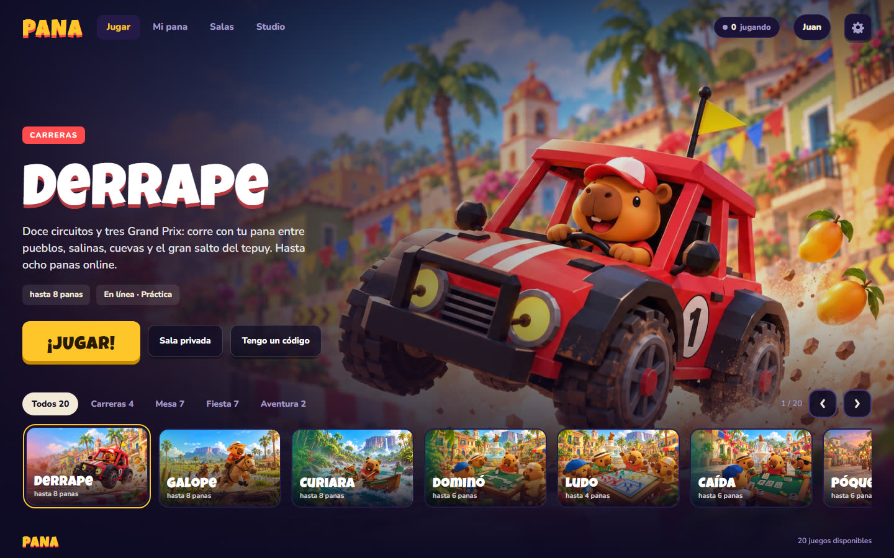
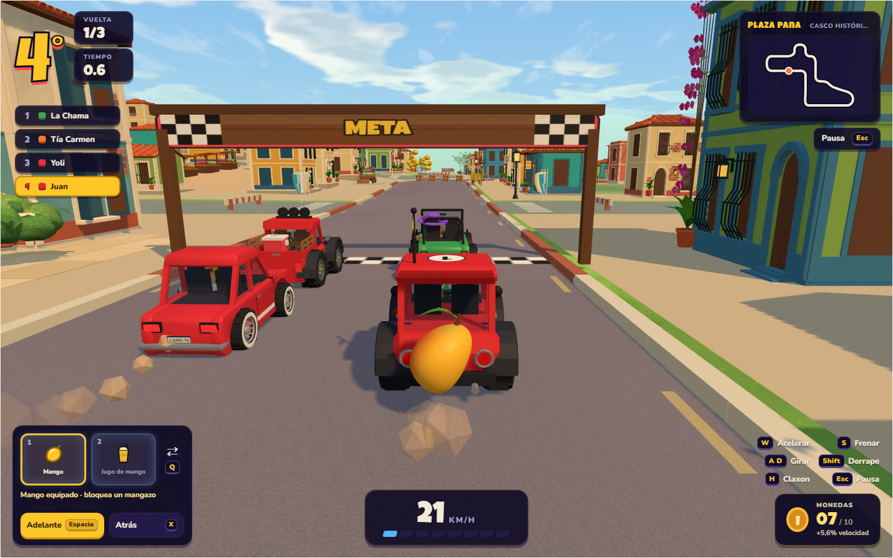
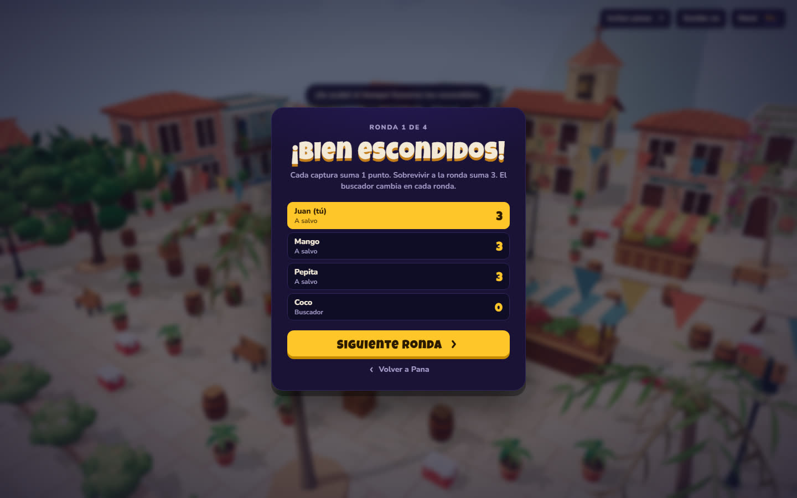
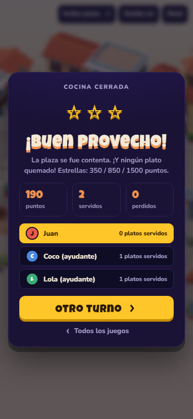

<h1 align="center">Pana</h1>

<p align="center"><b>Juega con tus panas.</b></p>

<p align="center">Free browser games for you and your friends · share a link, they join, nothing to install</p>

<p align="center">
  <a href="https://github.com/jhd3197/Pana/releases/latest"></a>
  <a href="https://github.com/jhd3197/Pana/actions/workflows/test.yml"></a>
  
  
</p>

<p align="center">
  
</p>

Pana is a hub of 3D party games that run in the browser. You make your pana (a
capybara with your hat, glasses and outfit) once in the hub, and it plays every
game with you: it drives your car, rides your horse, cooks your arepas and sits at
the domino table. Open a game, send the link to your friends, and they're in the
same room.

## Games

| Game | What it is | Players |
|---|---|---|
| **Derrape** | Toy-car racing on twelve circuits and three four-race Grand Prix cups, with items, coins and swappable wheels | 1–8 online; local split screen |
| **Bululú** | Island or harbor party board, with a minigame every round | 1–6, bots fill seats |
| **Escondidas** | Prop hunt in a market plaza: hide as a barrel, crate or bench | 1–8, bots fill in |
| **Pana Cocina** | Cooperative cooking shifts with configurable orders and kitchen rules | 1–8, bot helpers |
| **Galope** | Horse racing around a Llanos ranch, through esteros and over logs | 1–8, bots fill in |
| **Reliquia** | Cooperative expedition into a mine and the temple beneath it | 1–8 |
| **¡Embuste!** | Social deduction at the night camp: who is the mummy? | 4–8 online, bots for practice |
| **Curiara** | Dugout-canoe races with solo paddlers or two-person crews | 1–8, bots fill in |
| **Dominó** | Individual or team dominoes with configurable hands and scoring | 1–6, bots fill seats |
| **Caída** | Spanish cards to 24 points, individually or in teams | 1–6, bots fill seats |
| **Póquer** | Texas Hold'em or Omaha with free chips and configurable betting limits | 1–6, bots fill seats |
| **Ludo** | Roll, capture and race your four pieces home at a plaza table | 1–4, bots fill seats |
| **Billar** | Eight/nine-ball pool with rotating teammates and timed shot charging | 2, 4 or 6 online, or practice |
| **Bolas Criollas** | Roll close to the mingo or knock the rival's ball away, in teams | 1–6, bots fill seats |
| **¿Quién quiere ser mi pana?** (QQSMP) | TV-style trivia: everyone answers in secret at once, climbs a ladder of mangos and bets the final | 1–6, bots fill seats |
| **Chapita** | Barrio baseball with a bottle cap and a broomstick: read the float, the drop or the curve; where the cap lands is the hit | 1–8 in two teams, bots fill seats |
| **¡Stop!** | The notebook word game: a letter, a secret sheet, ¡STOP!, then the table votes on what counts | 1–8, bots fill seats |
| **La Rueda de Tambor** | A tambor party: drum the beat, dance the MCP's calls in the middle or get thrown out of the rueda; plus Relevo, Toque libre and ¡Golpe! | 1–8, bots fill drums and crowd |
| **Pepazo** | Paintball between barricades: aim, paint your rivals, respawn | 1–8, bots fill in |

## Screenshots

**Derrape:** race your pana with a mango and a jugo in your two item slots.



**Every game ends on the same card:** standings, your row highlighted, one button to play again.

<p>
  
  
</p>

## Play

The public site is on its way at **pana.sh**. Until then, run it on your computer
and share it on your network:

```powershell
git clone https://github.com/jhd3197/Pana
cd Pana
npm install
npm start                 # or .\dev.ps1 on Windows
```

Open http://localhost:8461. The dev script also prints a LAN address: friends on
the same Wi-Fi open that, pick a game, and press *Invitar panas* to share the room.

- **Pana Studio** (`.\dev.ps1 studio`): every shared character, prop, vehicle and
  map with a live 3D preview and its source file.
- **Character editor**: `/personaje.html` — visual wardrobe, accessory previews,
  undo/redo and outfit codes; save the complete look for every game.

## Releases

Every merge from `dev` into `main` is a release. The workflow stamps the
`## Unreleased` notes in [CHANGELOG.md](CHANGELOG.md) with the next version, tags it,
and publishes them as a [GitHub release](https://github.com/jhd3197/Pana/releases).
What changed and when is always in the changelog.

## Develop

One Node server, a static hub and one folder per game: plain ES modules with **no
build step**, Three.js from a CDN, and Colyseus rooms for online play.

```powershell
npm run check             # syntax check of every .js file
npm test                  # unit tests + house-rule checks (no browser needed)
npm run test:browser      # Playwright suites (installed by npm install)
.\dev.ps1 check -Browser  # all of the above
```

```
README.md, AGENTS.md, CHANGELOG.md, dev.ps1, package.json
docs/                  architecture, deployment, knowledge/ (notes per area), screenshots/
Pana/
├── server/            HTTP, API and Colyseus rooms
├── web/               the hub, character creator and Pana Studio
├── games/<game>/      game.json + public/ (rules.js, network.js, scene.js, game.js) + tests/
├── engine/            shared code: kit, menu, rooms, invites, results, icons, models
├── scripts/           test runner and release tooling
└── tests/             house-rule checks
```

- [docs/ARCHITECTURE.md](docs/ARCHITECTURE.md): request flow, a game's files, rooms.
- [docs/DEPLOYMENT.md](docs/DEPLOYMENT.md): running it for real on pana.sh.
- [docs/knowledge/](docs/knowledge/README.md): notes per game and per area.

## Contributing

Work happens on `dev`; `main` only takes merges from it. This repo is built largely
by AI coding agents, so start with [AGENTS.md](AGENTS.md); it's short. A change
players will notice adds a line under `## Unreleased` in
[CHANGELOG.md](CHANGELOG.md) in the same commit: that line becomes the release notes.
