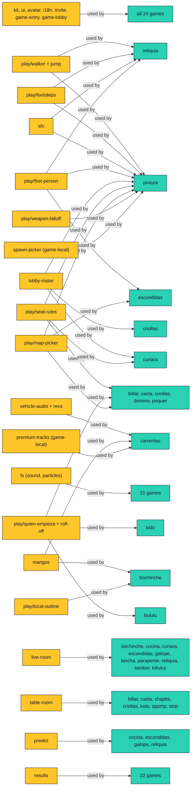

# Shared engine map

Read this before you build a mechanic. If a row below already does it, use it.
If you build something a second game could use, put it in `Pana/engine/` (`play/`
for mechanics, the kit for pages) and add a row here in the same change. How to
extend the rest of the engine lives in `AGENTS.md` ("Shared pieces") and
`Pana/engine/README.md`; this file is the map of who uses what.

"Used by" comes from imports found with `git grep` over `games/*/public` on
2026-10-30 (the audit commands are at the bottom). It lists games that import the
module, not games that merely look alike. All paths are relative to `Pana/`.

- **Shared** means two or more games import it.
- **Game-local** means it is good and generic but still lives in one game: a
  promotion candidate, listed under "Migration candidates".

## On foot

### Player controller (walk, sprint, stamina, collision)

`engine/play/walker.js`. `stepWalker(p, input, dt, opts)` is pure and runs on the
host and in a guest's prediction: movement vector, sprint with stamina, optional
inertia, collision through the game's own `move`, the jump and the floor height.
The game keeps its rules and passes numbers (`walk`, `run`, `canSprint`).

```js
import { stepWalker, axisMove } from '../../../engine/play/walker.js'; // relative: rules.js also loads on the server
const r = stepWalker(p, input, dt, { walk: 7, run: 10, canSprint: !input.fire, move: axisMove((x, z) => blocked(x, z)) });
p.sprint = r.sprinting;
```

Used by: Reliquia, Pepazo. Notes: `docs/knowledge/shared-player.md`.

### Jump

`engine/play/jump.js`. `pressJump(count)` (an 8-bit press counter so a press
survives a dropped packet), `jumpCount(input)`, `stepJump`, `resetJump`.
`stepWalker` calls it; a game with its own movement can call `stepJump` alone.

```js
input.jump = pressJump(input.jump);   // client, on the key edge
```

Used by: Reliquia, Pepazo, Capis a Pintazos (the press counter, through `side-walker.js`).

### Footsteps, take-off and landing

`engine/play/footsteps.js`. `createFootsteps()` returns a ticker that fires a step
every few metres (a longer stride when sprinting), alternating feet, plus take-off
and landing sounds, through `engine/sfx.js`.

```js
const feet = createFootsteps();
feet.update(dt, { speed, height: p.jumpHeight, sprint, surface: 'wood' }, sfx);
```

Used by: Reliquia, Pepazo.

### First-person look

`engine/play/first-person.js`. `createLookControls(canvas, {look, press, release})`
(mouse and touch look, pointer lock handling) and the saved sensitivity
(`loadSensitivity`, `SENSITIVITY_CHOICES`).

Used by: Escondidas, Pepazo, Reliquia.

### Side view: destructible ground and walking on it

`engine/play/terrain-mask.js` (pure): a grid of solid/air cells with a paint
layer, row 0 at the bottom. `createMask`, `fillHeights`, `carve` (round
crater), `fill`, `splash` (paint that fades to the rim), `drips` (seeded streaks
of paint running down from a blast and blobs thrown past its rim), `solidAt`,
`groundBelow`, `surfaceY`, `slopeAt`, `circleHits`, `surfaceNormal`, `stainAt`,
`markDirty`/`takeDirty`, and `paintRGBA` (texture bytes: grass on every top
surface, earth darkening with depth, paint blended over; upload as a
`THREE.DataTexture`, no canvas). Optional palette keys add a beach (`sand`,
`wet`, `sandBelow`), bare crater floors (`grassAt`), rock strata (`rock`,
`rockAt`), roots, grass blades drawn into the air (`fringe`), shade under
overhangs (`shade`) and darkening by height (`deepFrom`).

`fieldRGBA` writes the same ground as fields for a shader instead of colours
(a vertical signed distance smoothed along x, a blurred coverage, rock, bare
tops, paint, wide coverage for occlusion, the distance to air below), and
`coverageContour` traces the smooth outline (marching squares with normals).
`engine/play/terrain-material.js` (Three.js) draws them: `createTerrain(scene,
mask, { palette, rockAt, grassAt, zBack, zFront, back, renderer })` builds the
front face, a wall extruded from the outline and an optional back wall (the
starting ground plus `mask.hollow`), three draws in all, with soil, strata,
pebbles, roots, rock, sand, a grass band with short tufts and the paint all
computed in the fragment shader (Lambert lighting and fog kept).
`palette.strata` (keys of `DEFAULT_STRATA`: topsoil, ash, clay, pumice, ochre,
loam, base and seam colours, `period`, `fold`, `tilt`, `phase`) sets the soil
profile; `setStrata(strata)` swaps it for the next map without a rebuild.

**Strata.** The bands are read from the ground as it was at `reset()`, never
from the ground now, so a crater cuts through them and nothing pops or
stretches: the field is copied into a start texture (depth, coverage, wide
coverage, bare) and `smoothTops(mask, { extra, wide, narrow })`
(terrain-mask.js, pure) gives the starting top per column smoothed wide and
narrow, uploaded as a one-row half-float texture. A point's place down the
profile is `fold` x its depth under the smoothed top plus the rest level (the
bands drape over hills and fold gently instead of running parallel to every
bump), waved and thickened along x by noise; runs of seven bands of five
kinds repeat every `period` units with shares, swaps and swells hashed per
run, some contacts sharp, some graded, some with a thin dotted seam. The
topsoil, the root fringe and the grass cover use the starting depth too, and
where the coverage is now lower than at the start (a crater) the new face is
scorched, charred right at the edge. Two texture taps more than the plain
soil and about 30 value-noise lookups a pixel; no mesh, draw or pass added.
`update(takeDirty(mask))` after a blast or a splash (it rebuilds the outline
only when cells changed between solid and air), `reset(mask)` for a new
match, `fallback()` for a plain cut-out ground if the shader cannot compile.
`terrainMaterial` alone gives the material.

`engine/play/side-walker.js` (pure): `stepSideWalker(p, input, dt, mask, opts)`
walks a body left and right over the mask, steps over bumps, refuses bare
slopes steeper than `maxClimb`, slides down painted slopes (`slick`,
`slipAngle`), jumps on `jump.js`'s press counter, falls off ledges and into the
water (`drowned`); `knock(p, vx, vy)` throws it, `settled(p)` says it stopped.
It only lands with ground under the feet (brushing a rounded lip is a wall to
slide off), and a body wedged in a narrow V rests on the floor under it.

`engine/play/terrain-gen.js` (pure): building and checking side-view ground
from a seed. `seededStream(key)` (one stream per seed and attempt, so a re-roll
replays), `bumps(d, hills)` (gaussian hills and hollows), `dropFloating(mask,
max)` (removes ground not joined to the bottom row, reports bigger pieces),
`topLine`, `walkSpans` (stretches a walker covers: walkable slopes and hops),
`walkTo(mask, x, dir)` (how far a walker gets one way, down ledges included),
`skyExposure` and `headroom`; `floorGraph(mask, { water })` (every floor a
walker stands on, caves, tunnels and bridges included, with walk, drop and
hop edges: `reach`, `distance`, `near`, `layered`), `coverToward(mask, x, y,
dir)` (how sheltered a spot is from one side) and `relief(mask)` (relief,
bumpiness and dry share of the top). The game keeps its own design (Capis:
`games/capis/public/map-rules.js`).

```js
import { createMask, carve, splash } from '../../../engine/play/terrain-mask.js';
import { stepSideWalker, knock } from '../../../engine/play/side-walker.js';
carve(mask, x, y, 3.5); splash(mask, x, y, 4.6, team);
const r = stepSideWalker(capy, { x: dir, jump }, dt, mask, { water: 4 });
```

Used by: Capis a Pintazos. Notes: `docs/knowledge/capis.md`.

### Spawn picker (game-local)

`games/pintura/public/spawn-picker.js`. `rankSpawns` and `pickSpawn`: pure,
seeded, choose the spawn farthest from enemies and not recently used, with an
optional line-of-sight test. Nothing in it is about paint.

Used by: Pepazo only. Promote to `engine/play/spawn-picker.js` when a second game
needs it (see candidates).

## Weapons and projectiles

### Projectiles (level flight, swept collision)

`engine/play/projectile.js`. Pure, so a server room and Node tests run the same
flight: `launch(ax, az, speed, angle)`, `sweep(ball, dt, { boxes, targets, padding, y })`
(the earliest cover box or round target along this step's segment, so a fast
ball never tunnels; with `y`, the flight height, boxes no taller than it are
flown over), `segmentBox`, `segmentCircle`, `traceRay` (where a tracer
line ends, same `y`) and `flightTime`.

```js
import { launch, sweep } from '../../../engine/play/projectile.js'; // relative: rules.js also loads on the server
const { t, victim, dx, dz } = sweep(ball, dt, { boxes: cover, targets: rivals, padding: .12 });
```

Arcs in a 3D court: `sweepArc(ball, dt, { boxes, targets, radius, height, gravity })`
sweeps one gravity step `{ x, y, z, vx, vy, vz }` as its chord against cover
boxes with a height (a low crate is flown over), upright round targets and the
ground (`hit`: 'cover' | 'target' | 'ground'), and `stepArc(ball, dt, gravity)`
moves it on. `engine/play/melee.js` throws with them.

Used by: Pepazo (every ball and rocket, the sniper tracer, the thrown chancla).

### Collision debug (colliders vs what you see)

`engine/play/collision-audit.js` (pure): `auditColliders(colliders, solids, { map,
variant, shotHeight, allow })` measures each collider `{ id, source, x, z, w, d,
h, blocksShots, blocksMovement, health }` against the visible triangles inside
it and flags `no-mesh` (an orphan), `oversized` (under half its footprint or
60% of its height filled), `under-shot` (stops shots though its mesh is lower
than they fly) and `damaged` (health under 1 but still stopping shots), each
with a proposed `fix` (`remove`, `refit` to the mesh box, `split` into one box
per separate piece, `unblock-shots`). `allow` lists ids or sources that are invisible on purpose.
`engine/play/collision-debug.js` (Three.js, load it only when asked):
`collectSolids(root)` turns a map's meshes (baked and instanced too) into those
boxes; `createCollisionDebug(scene)` adds `audit`, colour-coded wireframes
(`show`), a console table and `download` (JSON).

Used by: Pepazo (`?debugCollision=1` or F9, Shift+F9 saves the report;
`npm run collision-report` audits every court headless into `Pana/reports/collision/`;
`--fix` records the fixes in `games/pintura/public/collision-fixes.js`). A box with
`shots: false` never stops a level `sweep`.

### Melee weapons (one target per swing, throwable)

`engine/play/melee.js` (pure, renderer-free). A weapon is data: `{ reach, arc,
windup, recovery, damage, knockback, sweetSpot?, throwable? }`; `throwable` is
`{ speed, lift, gravity, radius, damage, life, recall, returns: 'recall' | 'pickup' }`.
`createMelee()` is the state (`phase` ready / windup / recover / away, counters
`swings` and `throws`); `startSwing`, `stepMelee(state, def, dt)` (says
`'strike'` the step the windup ends, `'return'` when a thrown weapon is back,
`'ready'`), `swingHit(pose, targets, def, { boxes, radius })` (the ONE nearest
target in reach and inside the facing cone with no cover between, plus the
sweet-spot damage), `throwStart(state, def, pose)` (the projectile; the weapon
leaves the hand), `stepThrown(flying, dt, { boxes, targets })` (gravity arc on
`projectile.js`'s `sweepArc`), `readiness` (0..1 for a HUD bar), `recall`,
`swingInterval` and `aimThrow(def, distance)` (the pitch that reaches a target:
bots). Tests: `engine/tests/melee.test.js`.

```js
import { startSwing, stepMelee, swingHit, throwStart, stepThrown } from '../../../engine/play/melee.js'; // relative: rules.js also loads on the server
if (input.fire) startSwing(p.melee, def);
if (stepMelee(p.melee, def, dt) === 'strike') { const hit = swingHit(p, rivals, def, { boxes: cover }); if (hit) paint(hit.target, hit.damage); }
```

Used by: Pepazo (Los del pescozón: six melee weapons; La Chancleta's throw).

### Lobbed shots seen from the side (gravity and wind)

`engine/play/ballistic.js` (pure). `aimVelocity(angle, facing, speed)`,
`stepFlight(ball, dt, { wind, solid, targets, bounds })` (gravity, a sideways
wind push, the step swept against the ground predicate and round targets with
`projectile.js`'s `segmentCircle`, so nothing tunnels) and
`simulateFlight(start, opts)` (the whole arc and where it ends: the aim
preview and a bot's shot search use the same flight). `FLIGHT` holds the
default gravity (18) and wind force (7).

```js
const ball = { x, y, ...aimVelocity(angle, facing, power * 32) };
const { hit, victim } = stepFlight(ball, dt, { wind, solid: (x, y) => solidAt(mask, x, y), targets });
```

Used by: Capis a Pintazos (La Bazuca de pintura, its aim preview and the bot).

### Thrown lobs in a 3D court (bounce, roll, blast falloff)

`engine/play/lob.js` (pure, renderer-free). `lobVelocity(ax, az, elevation, speed)`,
`stepLob(g, dt, { boxes, bounds, restitution, friction, roll, sticky })` (gravity;
floor and box-top bounces; box sides taller than the throw and the court's edge
reflect it; it rolls to `resting`; fast throws are sub-stepped so nothing
tunnels), `traceLob(start, opts, { dt, time, out, land })` (the whole throw into
reused points: where it lands first, its peak and where it is when the fuse
ends; `land` waits for touchdown), `groundAt`, `touched`, `falloff(distance,
radius)` (1 inside 40%, down to 0.35 at the edge) and `solveLob(reach, distance,
{ pitches })` (pitch and 0..1 power for a distance: bots, auto-aim). Boxes are
cover `{ x, z, w, d, h }`, the same as `projectile.js`.

```js
import { stepLob, traceLob } from '../../../engine/play/lob.js'; // relative: rules.js also loads on the server
stepLob(grenade, dt, { boxes: cover, bounds: { x: 27, z: 27 }, restitution: .4 });
const end = traceLob(start, opts, { dt: TICK, time: fuse, out: points, land: true }); // preview = server
```

Used by: Pepazo (grenades: the server flight, the aim arc, bots and the armory range).

### Damage falloff with range

`engine/play/weapon-falloff.js` (pure). A weapon's config `{ near, far, close,
min, round }` deals `close` up to `near` metres, then a straight line down to
`min` at `far` and beyond (never below `min`, rounded to whole units unless
`round: false`). `rangeDamage(config, distance, base)` gives the damage after
`distance` metres; with no config it returns the flat `base`, so a weapon
without one behaves as before. `falloffConfig(config)` validates and fills the
defaults. Tests: `engine/tests/weapon-falloff.test.js`.

```js
import { rangeDamage } from '../../../engine/play/weapon-falloff.js'; // relative: rules.js also loads on the server
const damage = rangeDamage(stats.falloff, Math.hypot(ball.x - ball.x0, ball.z - ball.z0), stats.damage);
```

Used by: Pepazo (La Lejana's body hits: 3 up to 10 m, 1 from 50 m).

### Scope and aim zoom

`engine/play/scope.js`. `createScope({ zoom })` eases a 0..1 aim blend in and out
and gives the narrowed `fov(base)`, the slower look `sensitivity()` and `scoped`
(past which the held weapon hides). `createScopeOverlay(document)` is the
full-screen scope picture (vignette, posts, hairlines, a lit dot). `scopedFov`
and `lookScale` are the pure formulas.

```js
const scope = createScope({ zoom: 3.5 }); scope.update(dt, aiming);
camera.fov = scope.fov(72); look(yaw * scope.sensitivity(), pitch * scope.sensitivity());
```

Used by: Pepazo (La Lejana scopes 3.5×, the other markers zoom 1.2×).

### Recoil and camera shake

`engine/play/recoil.js`. `createRecoil()`: `fire({ cam, shake })` kicks and climbs
the view, `shake(amount)` trembles it (hits, explosions), `update(dt, { decay })`
returns `{ kick, pitch, yaw, roll }` to add to the camera or a held model. No
`Math.random`: the shake is a sum of sines, so tests are exact. `shakeAt(distance,
power)` is how hard a blast that far away shakes you.

Used by: Pepazo (the first-person camera and the viewmodel kick), Capis a Pintazos (the side camera's kick and blast shake).

### Explosions, smoke trails and tracers

`engine/play/blast-fx.js` (Three.js). `createBlastFx(scene, puffs)`: `boom({ x, z,
size, color })` (flash, fireball, shock ring, smoke, paint and embers),
`trail(id, at, dt)` (smoke behind anything flying), `tracer(from, to)` (a bright
line that fades) and `update(dt)`. Visual only; when and where come from the
game's state. Sound is `sfx.boom(size)`. `boom({ ground })` sets the shock
ring's height (default .08, the floor); a side-view game passes the impact's,
and `boom({ front: true })` stands the ring up facing the camera's side.

Used by: Pepazo (La Bazuca and El Cohetón rockets, grenades, La Lejana's tracer),
Capis a Pintazos (the paint bazooka's blast).

### Flying bits: drops, clods, sparks, water rings

`engine/play/spray.js` (Three.js). `createSpray(scene, { shape, capacity, additive,
gravity, drag })`: a pool of bits drawn as one `InstancedMesh` (one draw while
any fly, none when idle), no allocation per frame or per bit. Shapes `drop clod
chip spark ring`. `burst(at, { count, color, speed, dir, cone, size, life, grow })`;
`update(dt, { solid, water, onWater })` adds gravity and drag, sticks a bit where
`solid(x, y)` (a flattened drop that soaks in) and drops it at the water line
with a callback for a ripple. `additive` bits glow and fade; `ring` bits lie
flat and grow.

```js
const drops = createSpray(scene, { shape: 'drop' });
drops.burst({ x, y, z }, { count: 40, color: '#e8569b', speed: 12, dir: { x: 0, y: 1 }, cone: 1.2 });
drops.update(dt, { solid: (x, y) => solidAt(mask, x, y), water: 4.2, onWater: ripple });
```

Used by: Capis a Pintazos (paint and water drops, clods of earth, sparks, rings
on the river).

### Paint markers, La Bazuca and its rocket

`engine/models/props/paintball-kit.js` (Three.js). `createPaintKit({ weapon, color,
attachments, charm, pattern, camo })` builds one of eighteen markers (`pistol
scatter rapid rocket sniper bazooka smg minigun slingshot revolver blunderbuss
sprayer sixshooter pdw carbine bullpup marksman lmg`; an unknown id draws La
Chispa) or a Studio melee piece: origin at the grip, +Z down the barrel,
`userData.tip` the muzzle's z, `userData.sight` the sight line (`sightX` its
sideways offset for side-mounted sights), `userData.bore` the barrel axis
height, `userData.optic` the Mira kind when one is fitted, `userData.class`,
`userData.spin` (a group to turn when firing: La Licuadora, the revolvers).
Attachments `barrel hopper stock optic` sit on each marker's own mounts.
`PAINT_KIT_BORE[weapon]` is the barrel axis height for all eighteen.
`bakePaintKit(options)` is the same marker batched into a few draws (finishes
folded to matte, glossy and metal, one draw each), with `tip`, `sight`,
`sightX`, `optic` and `bore`; `.clone()` shares it, so a scene holding six
launchers in third person pays for one.
`createPaintRocket({ color })` is La Bazuca's round in flight (+Z the nose).
`createPaintGrenade({ color })` is Pepazo's paint grenade (about 30 cm, upright,
origin at its centre; `userData.light` is the fuse lamp's material to blink).
`createPaintVest()` is El Acolchado, a plate carrier in a pana's world units (one
vertex-coloured mesh); `wearPaintVest(character, vest?)` puts it on a
`buildCharacter()` pana's body so it follows the walk bob and lean.

Camo goes on by id only: `camo: '<id>'` names a `PAINT_CAMOS` pattern (selva,
medanos, bolivar, caracas, caribe, jaguar, llanero, rumba, tricolor, pepazo) or
a `PAINT_SOLIDS` colour (`liso-mango`, `liso-caribe`, `liso-uva`, `liso-crema`,
`liso-carbon`, `liso-coral`); free colour objects are ignored (`resolveCamo`).
A solid one only recolours the painted body (`userData.camo.pattern` is
`'solid'`, no shader, no extra attribute). A pattern is a shader hook on the
painted body (`applyCamo`, patterns in `CAMO_PATTERNS`) reading a `camoPos`
attribute baked in model space, so it wraps every part without UVs. All camo
materials share one program (`customProgramCacheKey` is the fixed
`'pana-camo'`; colours and pattern are uniforms set once per material at
compile, nothing per frame), and `engine/models/core/static-batch.js` keeps
`camoPos` through a bake. Used by Pepazo (its armory, held and third-person
markers); who owns which camo is the game's rule, not the model's.

The data behind it is `engine/play/paint-arsenal.js` (no Three.js, safe in
rules and on the server): `PAINT_WEAPONS` (id → name, menu order),
`PAINT_MELEE`, `PAINT_CLASSES` (eight marker classes plus granadas and melee;
nickname and kind through `loc()`), `classOf(id)`, `PAINT_MOUNTS` (which
attachments each model has a mount for), `PAINT_OPTICS` (the Mira kind each
model draws: dot, holo, laser, scope, pin), `PAINT_KIT_BORE`, `PAINT_CAMOS`,
`PAINT_SOLIDS` and `PAINT_CAMO_IDS` (every camo id, solids first). The kit
re-exports all of it. Pepazo's `armory-data.js` builds its markers, attachment
rules and optic tuning from it; `games/pintura/tests/paint-kit.browser.js`
builds every marker with every allowed attachment set and keeps the model and
the table in agreement.

```js
const launcher = bakePaintKit({ weapon: 'bazooka', color }), held = launcher.clone();
held.position.set(0, -launcher.userData.bore * s, 0);   // barrel axis through the pivot
```

Used by: Pepazo (every marker in first and third person, the in-flight rocket),
Capis a Pintazos (La Bazuca in every capi's hands, batched; the rocket in flight).

## Sound

### SFX library

`engine/sfx.js`. One synthesised library, no audio files, on the same WebAudio
context and voice budget as `fx.js`: `step(surface)`, `jump`, `land`, `shot(kind)`,
`impact`, `splat`, `boom(size, { far })`, `debris`, `patter`, `hitConfirm`, `hurt`, `reload(kind)`, `reloaded`, `dry`,
`swap`, `swish`, `tick`, `confirm`, `back`, `count`, `go`, `boing`, `squeak`,
`splash(size)`, `chime`, `sting(win)`. Shots include `sniper` and
`bazooka`; reloads include `bolt`. Building blocks: `burst`
(filtered noise) and `pitch` (tone). A game asks for what a sound is, never how it
is built.

```js
import { sfx } from '/engine/sfx.js';
sfx.shot('scatter'); sfx.step('grass', { sprint: true, foot: 1 });
```

Used by: Pepazo, Reliquia (steps, jump, landing), Capis a Pintazos (bazooka,
boom with distance, debris, patter, splat, boing, squeak, splash, chime, tick, sting). Notes: `docs/knowledge/shared-sfx.md`.

### Vehicle audio

`engine/vehicle-audio.js` (`createMotor`, `createTyres`, `vehicleSfx`) and its pure
half `engine/vehicle-revs.js` (gearbox and rev model, unit-tested). Profiles:
`compact sport muscle truck beetle bus boat`.

```js
const motor = createMotor(sound, { profile: 'muscle', topSpeed: 42 });
motor.update(dt, { speed, boost });
```

Used by: Carreritas (tyres, boost, crash, via `drift-audio.js`). Carreritas' car motor is the older `sound.startEngine` putt-putt in `engine/fx.js`, which sounded better to players than `createMotor`; `createMotor` has no user right now.

### `fx.js` sound, particles and bubbles

`engine/fx.js`. `sound` (the older shared effects and the one audio context),
`Puffs`, `Shockwaves`, `Debris`, charge ring, speed lines, `popCounter`,
`flyToCounter`, speech bubbles. Used by 21 games (all but Billar, Caída
and Dominó, which load it on first use through `engine/lazy-sound.js`).
`engine/sfx.js` sits on top of it.

### Music

`engine/music.js` (+ `music-tracks.js`): songs, styles, the lobby song.
Used by: Carreritas, Curiara, Lancha, Parapente; the lobby plays it for every game
through `game-entry.js`.

## Lobby, menus and the match flow

### Lobby and ready handshake

`engine/game-entry.js` (page `data-pana-entry`) paints the illustrated lobby
before the game's module graph loads, tracks each player's `lobbyReady` and
`assetsReady`, and holds the start barrier until everyone is ready. Styling:
`engine/game-lobby.css`, `engine/banderin.css`, `engine/sala.js` + `sala.css` (the
Sala layout). A game opts in by exporting `sceneReady` (a promise); the others
go through `engine/game-load.js` (`prepareScene`: compile and render once before
the cover lifts).

Used by: game-entry and game-lobby in all 24 games; `sceneReady` in Bochinche,
Caída, Carreritas, Chapita, Dominó, Ludo, Parapente, QQSMP, Stop, Tambor,
Trifulca; `game-load` in Billar, Bululú, Caída, Cocina, Criollas, Curiara,
Dominó, Embuste, Escondidas, Galope, Lancha, Ludo, Pepazo, Póquer, Reliquia.

### Round countdown (not shared)

Nothing in the engine draws the "3, 2, 1, ¡ya!" before a round. Eight games
write their own (Bochinche, Bululú, Carreritas, Curiara, Galope, Lancha,
Parapente, Pepazo). The only shared part is the beep: `sfx.count()` and `sfx.go()`, used by Pepazo.
See candidates.

### Roster, seats and starter

| Piece | Module | Used by |
|---|---|---|
| Lobby roster cards (portrait, drag seats) | `engine/lobby-roster.js` | Criollas, Curiara, Pepazo (and `game-entry` for all) |
| Seat swapping rules | `engine/play/seat-rules.js` | Billar, Caída, Criollas, Curiara, Dominó, Pepazo, Póquer |
| Table seating UI | `engine/play/table-seating.js` | Billar, Caída, Dominó, Póquer |
| Seat bubbles (frases) | `engine/play/seat-bubbles.js`, `play/frases.js` | Caída, Dominó, QQSMP, Stop (bubbles); Caída, Dominó, QQSMP, Reliquia (frases) |
| ¿Quién empieza? (roll-off for the first turn) | `engine/play/quien-empieza.js` + `-rules.js`, `play/roll-off.js` | Billar, Bululú, Caída, Criollas, Dominó, Ludo, Póquer |
| Map picker | `engine/play/map-picker.js` | Billar, Caída, Criollas, Dominó, Escondidas, Pepazo, Póquer |
| Results → lobby (pick the next map) | `engine/play/round-lobby.js` (`returnToLobby`; LiveRoom's `lobby` action calls `game.toLobby()`) | Escondidas, Pepazo, Trifulca |
| Difficulty picker | `engine/play/difficulty.js` | Billar, Criollas, Pepazo; Capis a Pintazos reads the levels for its bot and aim preview |
| Room options (fields, rules, finalize; compact "Más ajustes" grid in the game skin, in-dialog help layer via `help: { controls, tips }`) | `engine/room-options.js`, `room-options.css`, `room-options-rules.js`, `room-option-fields.js` | 23 games; fields in 13; help layer in Pepazo |
| Results screen | `engine/results.js` + `.pk-results` | 22 games (not Bululú, Embuste) |

### Team objectives: flags and capture zones

`engine/play/objectives.js`. Pure, no Three.js: a server room, a practice host
and a unit test run the same rules. Actors are `{ id, team, x, z, alive }`
built from the game's players each tick; every step returns events
(`pickup`, `drop`, `return`, `capture`; `captured`, `neutral` for zones) the
game turns into scores, feed lines and sounds.

- Flags: `createFlag(team, stand)`, `stepFlags(flags, actors, dt, rules)`
  (carrier follows, drop on death or leave, capture only with your own flag
  home, own-team touch returns a dropped flag, rival touch lifts it, auto-return
  after `returnAfter` s), `dropCarried`, `carriedBy`, `returnFlag`.
- Zones: `createZone(id, { x, z, radius, captureTime })`, `stepZone(zone,
  actors, dt)` / `stepZones(zones, actors, dt)` (lone team turns it, +50% per
  extra pana up to 3×; two teams contest it; a rival's zone is neutralised
  first; an empty zone drifts back to its owner; events `contested`, `neutral`,
  `captured`), `zoneOccupants`, `zonesHeld(zones)`, `zonePoints(zones, bank, dt,
  perSecond)` (hold scoring with a per-team fraction bank).
- Match end: `reachedLimit(scores, limit)`, `decideWinner(scores, tieBreaks)`,
  `flagTieBreaks(flags)` (flag at home, then fewer times taken),
  `zoneTieBreaks(zones)` (more zones held now).

```js
import { createFlag, stepFlags } from '../../../engine/play/objectives.js'; // relative: rules run on the server
const flags = stands.map((stand, team) => createFlag(team, stand));
for (const e of stepFlags(flags, actors, dt)) if (e.type === 'capture') scores[e.team]++;
```

Used by: Pepazo (capture the flag, `games/pintura/public/ctf.js`; domination,
`games/pintura/public/domination.js`). Tests: `engine/tests/objectives.test.js`,
`games/pintura/tests/ctf.test.js`, `games/pintura/tests/domination.test.js`.

## Rooms and netcode

| Piece | Module | Used by |
|---|---|---|
| Real-time room | `engine/live-room.js` (`LiveRoom`, `axis`, `elapsedClock`) | Bochinche, Cocina, Curiara, Escondidas, Galope, Lancha, Parapente, Reliquia, Tambor, Trifulca |
| Turn-based room | `engine/table-room.js` | Billar, Caída, Chapita, Criollas, Ludo, QQSMP, Stop |
| Client prediction | `engine/predict.js` | Cocina, Escondidas, Galope, Reliquia |
| Raw room and links | `engine/net.js` | Bululú, Carreritas, Dominó, Embuste, Pepazo, Póquer |
| Shell (load, loops, teardown) | `engine/game-shell.js` (`bootGame`) | 17 games |
| Invite links | `engine/invite.js` | all 24 (Capis a Pintazos through game-entry only) |
| Seeded random, noise | `engine/random.js` | 14 games |
| Gateway-vouched ownership (pana.sh signs `x-pana-camos` with `PANA_GATEWAY_SECRET`; `parseOwned(headers)` verifies the HMAC, timing-safe; mid-session `parseSub` + `newNonce` + `verifyRefresh` for a nonce-bound signed refresh) | `server/src/camo-trust.js`, read in a room's `onAuth(client, options, context)` | Pepazo (camos). The catalog and the bridge client stay game-local: `games/pintura/public/camos.js`, `camo-store.js` |

## HUD and UI

| Piece | Module | Used by |
|---|---|---|
| Look, fonts, `--pk-*` tokens | `engine/kit.css`, `engine/kit.js` | all 24 |
| One square UI style: `--pk-r*` radius tokens are 0, hard offset shadows (`--pk-drop`, `--pk-skin-shadow`); real circles (avatars, dots, swatches, joystick, spinners, balls) opt out with `var(--pk-radius-round)` | `engine/kit.css`; guarded by `tests/ui-square.test.js` (pana-kit.md, "One square style") | every page and game; Capis allow-listed while it is restyled |
| Game skin: the lobby room panel's look for any panel or dialog (`.pk-skin-panel`, `-card`, `-plate`, `-label`, `-chips`, `-btn`, `-go`, `-link`; `--pk-skin-*` tokens) | `engine/kit.css` (pana-ui.md, "Game skin") | the shared sala (`sala.css` reads the tokens) and "Más ajustes" in the 23 room-options games |
| Pause menu, settings, invite button | `engine/ui.js`, `engine/settings.js` | ui: all 24; settings: 16 |
| Icons (`lock` marks something not yours yet) | `engine/icons.js` | Billar, Bochinche, Bululú, Capis a Pintazos (through room options), Carreritas, Criollas, Ludo, Pepazo, Reliquia, Stop |
| Toast | `engine/hud.js` (`createToast`) | Billar, Caída, Capis a Pintazos, Cocina, Criollas, Curiara, Dominó, Embuste, Escondidas, Lancha, Parapente, Reliquia |
| Touch controls | `engine/touch.js` | 17 games |
| Gamepad | `engine/gamepad.js` | Carreritas, Trifulca; `ui`, `first-person`, `settings` and `game-entry` read pads for every game |
| One-time control hints: a small square line of keys for the device in use (keyboard, controller glyphs, touch), live switch on device change, gone on the first press, click or touch, at most once per session (`sessionStorage`, memory fallback); `pad.prompts: false` hides gamepad.js's always-on button bar | `engine/control-hints.js` (`mountControlHints`, `keyFor`; `.pk-control-hints` in `kit.css`) | Pepazo |
| River HUD, minimap, guide | `engine/river/hud.js`, `minimap.js`, `guide.js` | Curiara, Lancha (`river/hud` also Galope) |
| Combat HUD (Banderín style: race, pepas, hit arrow, KO plate) | `games/pintura/public/combat-hud.js`, `hud-model.js`, `hud-banderin.css` | Pepazo only (game-local) |
| Minimap | one per game | Bululú, Carreritas, Curiara, Embuste, Escondidas, Galope, Lancha, Pepazo, Reliquia each draw their own (Curiara and Lancha share `river/minimap`) |
| Shot charge and aim guide (`guideRibbon` strips, `guideBeads` for an arc in the air, `guideRing` for a landing or blast ring) | `engine/play/shot-charge.js`, `aim-guide.js` | Billar, Bululú, Capis a Pintazos, Criollas, Pepazo (charge: the grenade throw); Billar, Capis a Pintazos (dashed arc), Criollas (guide), Pepazo (grenade arc, ground strip and blast ring) |

## Player, look and rewards

| Piece | Module | Used by |
|---|---|---|
| Saved name and appearance | `engine/avatar.js` | all 24 |
| Pana model | `engine/models/characters/pana/avatar-model.js` | 19 games (not Curiara, Galope, Lancha, Parapente, Criollas) |
| Portraits | `engine/portrait.js`, `portrait-cache.js` | Bochinche, Trifulca |
| Wardrobe | `engine/wardrobe.js`, `wardrobe-preview.js` | Bochinche, Carreritas, Pepazo, Trifulca (the page also loads `wardrobe-preview` through `pana.sh`) |
| Mangos (shared currency) | `engine/mangos.js` | Bochinche, Carreritas |
| Feats, stats, kit rating | `engine/feats.js`, `stats.js`, `kit-rating.js` | Feats: Bochinche, Carreritas, Pepazo. Stats and kit rating: Carreritas, Pepazo |
| Text in other languages | `engine/i18n.js` (`loc`, `locn`, `locKey`) | all 24 |
| Your own pana's outline and marker | `engine/play/local-outline.js` | Bochinche; Capis a Pintazos (the marker only, over the capi whose turn it is) |

### Your own pana: outline and marker

`engine/play/local-outline.js`. `createLocalOutline(group, { color, thickness })`
adds an inverted-hull copy of every opaque mesh in a character (skinned bodies
follow the pose) with one shared BackSide material and a slow pulse;
`createLocalMarker({ color })` is a small bobbing diamond that draws over walls,
placed by the caller. Both return `update(dt)` and `dispose()`; call `dispose()`
before `disposeModel` on the root. The hulls share the source geometry, so the
helper never disposes it. Use it for the local player only.

```js
const outline = createLocalOutline(character.group), marker = createLocalMarker();
root.add(marker.group); marker.group.position.y = height * 1.2;
outline.update(dt); marker.update(dt);   // every frame
```

Used by: Bochinche.

## Worlds and models

- **3D models** live in `engine/models/` (`catalog.js` is the index; the
  inventory is `docs/knowledge/model-inventory.md`). The pieces most games share:
  `props/game-table` (14 games), `characters/pana/avatar-model` (18),
  `vegetation/plant-kit` (9), `props/plaza` (9), `vegetation/palm` (7),
  `effects/water-surface` (6). Everything else is used by one to four games.
- **Worlds** in `engine/worlds/`: `table-world` (Billar, Bochinche, Caída,
  Chapita, Dominó, Ludo, Póquer, QQSMP, Stop, Trifulca), `sky` (Bululú,
  Carreritas, Galope, Parapente, Pepazo, Reliquia, Tambor), `arena-layouts`
  (Billar, Caída, Criollas, Dominó, Escondidas, Pepazo, Póquer), `arenas`
  (Cocina, Escondidas, Pepazo), `look` (Pepazo, Reliquia, Tambor), `plaza`
  (Cocina, Escondidas), `bolas-world` (Bululú, Criollas), the island set
  (Bululú), the coastal set (Carreritas, Parapente), `colonial-street`
  (Trifulca).
- **Large runtime asset packs** (audio, big images, voice packs) are not engine
  modules. They ship as release ZIPs pinned in `server/src/asset-packs.json`
  and are served by the server. Add a file there, not to Git:
  `docs/knowledge/asset-packs.md`.
- **Premium hook** is game-local: `games/carreritas/public/premium-tracks.js` is an
  empty extension point that a private build replaces (extra circuits, cups,
  modes, music). The engine has no premium or entitlement layer, and no other
  game has such a hook (Cocina's `rules.js` only mentions the word in a recipe
  name). If a second game needs paid content, build one in the engine first.

### Far copies of animated models (level of detail)

| Piece | Module | Used by |
|---|---|---|
| One-draw far copy of a jointed model (a pana and what it holds) | `engine/models/core/rig-lod.js` (`createRigLod`) | Capis a Pintazos |
| Which copy to show at a distance, with hysteresis (pure) | `engine/models/core/lod-band.js` (`chooseFar`) | Capis a Pintazos |

`createRigLod(root, { pivots, cell })` merges every mesh visible under `root`
into one `SkinnedMesh` with one vertex-coloured material, each vertex bound to
its nearest ancestor in `pivots` (body, head, arms, legs, a held launcher), so
the far copy follows the animation the full model gets. `cell` welds vertices
(vertex clustering) for fewer triangles. `setFar(on)` swaps the copies by
layer mask, never `visible`, so game code that toggles meshes keeps working; a
hidden pivot collapses its part. For still props use `static-batch.js` or
`impostor.js` instead. A studio pana and its La Bazuca go from about 55 draws
to 1 and from about 56 k to 6.4 k triangles (cell 0.06).

```js
const lod = createRigLod(root, { pivots: [avatar.body, avatar.head, ...avatar.arms, ...avatar.legs, gun], cell: .06 });
lod.setFar(chooseFar(lod.far, camera.position.distanceTo(root.position), { far: 55, near: 47 }));   // every frame
```

## Diagram

Each arrow reads `module --> used by --> game`. Pieces every game imports are
collapsed into one node.



## Migration candidates

Found by pattern, not yet read line by line: check the game before you move it.

| Game | Has its own | Moves onto | Why it is worth it |
|---|---|---|---|
| Escondidas | on-foot speed and sprint in `rules.js` (4.6 / 6.2, no stamina), no jump or footsteps | `walker`, `jump`, `footsteps` | Already uses first-person look and `predict`; steps would make hiders audible |
| Cocina, Embuste, Trifulca | `x += ...` movement loops in `rules.js` | `stepWalker` (or `axisMove` alone) | One collision and speed model instead of three |
| Bululú minigames (Atrapa, Chinazo) | on-foot movement, sprint | `stepWalker` | Same |
| Bochinche | its own combat engine with spawns and respawns | `spawn-picker` | Pure and tested already; its audio is also outside `sfx` |
| Chapita, QQSMP, Tambor | raw `AudioContext` in `sounds.js` / `beat.js` | `sfx` for effects (voice packs and the beat stay) | One voice budget; no stray context |
| Lancha | its own "motor drone" in `game.js` | `vehicle-audio` (a `boat` profile exists) | The boat motor is already written |
| 8 games (see Round countdown) | their own round countdown | a shared `engine/play/countdown.js` (3-2-1-go overlay + `sfx.count/go`) | Same markup and CSS written eight times |
| Reliquia, Bochinche, Trifulca, Cocina | their own spawn lists | promote `spawn-picker` to `engine/play/` | Pure and tested already |
| Pepazo | `combat-hud`, `hud-model` | keep game-local until a second shooter exists | Do not promote early |
| 9 games | a minimap each | a shared round minimap | Pepazo's is the newest; river games have another |

Not on the list: the table games (Billar, Caída, Dominó, Póquer, Criollas, Ludo,
Chapita, QQSMP, Stop) have no on-foot movement, and Carreritas has its own car
physics by design.

## Reproducing the audit

```powershell
# which games import a module
git grep -l -E "engine/play/walker" -- 'Pana/games/*/public/*.js'
# every engine module and its importers
git ls-files 'Pana/engine/*.js' 'Pana/engine/play/*.js'
```

Imports are matched by path, so a game that loads a module through a re-export or
a dynamic `import()` with a variable path can be missed; fix the row if you find
one.
