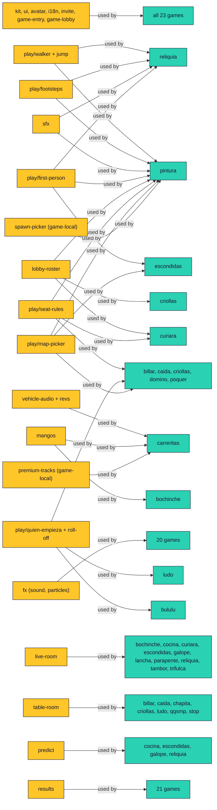

# Shared engine map

Read this before you build a mechanic. If a row below already does it, use it.
If you build something a second game could use, put it in `Pana/engine/` (`play/`
for mechanics, the kit for pages) and add a row here in the same change. How to
extend the rest of the engine lives in `AGENTS.md` ("Shared pieces") and
`Pana/engine/README.md`; this file is the map of who uses what.

"Used by" comes from imports found with `git grep` over `games/*/public` on
2026-10-30 (the audit commands are at the bottom). It lists games that import the
module, not games that merely look alike. All paths are relative to `Pana/`.

- **Shared** means two or more games import it.
- **Game-local** means it is good and generic but still lives in one game: a
  promotion candidate, listed under "Migration candidates".

## On foot

### Player controller (walk, sprint, stamina, collision)

`engine/play/walker.js`. `stepWalker(p, input, dt, opts)` is pure and runs on the
host and in a guest's prediction: movement vector, sprint with stamina, optional
inertia, collision through the game's own `move`, the jump and the floor height.
The game keeps its rules and passes numbers (`walk`, `run`, `canSprint`).

```js
import { stepWalker, axisMove } from '../../../engine/play/walker.js'; // relative: rules.js also loads on the server
const r = stepWalker(p, input, dt, { walk: 7, run: 10, canSprint: !input.fire, move: axisMove((x, z) => blocked(x, z)) });
p.sprint = r.sprinting;
```

Used by: Reliquia, Pepazo. Notes: `docs/knowledge/shared-player.md`.

### Jump

`engine/play/jump.js`. `pressJump(count)` (an 8-bit press counter so a press
survives a dropped packet), `jumpCount(input)`, `stepJump`, `resetJump`.
`stepWalker` calls it; a game with its own movement can call `stepJump` alone.

```js
input.jump = pressJump(input.jump);   // client, on the key edge
```

Used by: Reliquia, Pepazo.

### Footsteps, take-off and landing

`engine/play/footsteps.js`. `createFootsteps()` returns a ticker that fires a step
every few metres (a longer stride when sprinting), alternating feet, plus take-off
and landing sounds, through `engine/sfx.js`.

```js
const feet = createFootsteps();
feet.update(dt, { speed, height: p.jumpHeight, sprint, surface: 'wood' }, sfx);
```

Used by: Reliquia, Pepazo.

### First-person look

`engine/play/first-person.js`. `createLookControls(canvas, {look, press, release})`
(mouse and touch look, pointer lock handling) and the saved sensitivity
(`loadSensitivity`, `SENSITIVITY_CHOICES`).

Used by: Escondidas, Pepazo, Reliquia.

### Spawn picker (game-local)

`games/pintura/public/spawn-picker.js`. `rankSpawns` and `pickSpawn`: pure,
seeded, choose the spawn farthest from enemies and not recently used, with an
optional line-of-sight test. Nothing in it is about paint.

Used by: Pepazo only. Promote to `engine/play/spawn-picker.js` when a second game
needs it (see candidates).

## Weapons and projectiles

### Projectiles (level flight, swept collision)

`engine/play/projectile.js`. Pure, so a server room and Node tests run the same
flight: `launch(ax, az, speed, angle)`, `sweep(ball, dt, { boxes, targets, padding })`
(the earliest cover box or round target along this step's segment, so a fast
ball never tunnels), `segmentBox`, `segmentCircle`, `traceRay` (where a tracer
line ends) and `flightTime`.

```js
import { launch, sweep } from '../../../engine/play/projectile.js'; // relative: rules.js also loads on the server
const { t, victim, dx, dz } = sweep(ball, dt, { boxes: cover, targets: rivals, padding: .12 });
```

Used by: Pepazo (every ball and rocket, and the sniper tracer).

### Scope and aim zoom

`engine/play/scope.js`. `createScope({ zoom })` eases a 0..1 aim blend in and out
and gives the narrowed `fov(base)`, the slower look `sensitivity()` and `scoped`
(past which the held weapon hides). `createScopeOverlay(document)` is the
full-screen scope picture (vignette, posts, hairlines, a lit dot). `scopedFov`
and `lookScale` are the pure formulas.

```js
const scope = createScope({ zoom: 3.5 }); scope.update(dt, aiming);
camera.fov = scope.fov(72); look(yaw * scope.sensitivity(), pitch * scope.sensitivity());
```

Used by: Pepazo (La Lejana scopes 3.5×, the other markers zoom 1.2×).

### Recoil and camera shake

`engine/play/recoil.js`. `createRecoil()`: `fire({ cam, shake })` kicks and climbs
the view, `shake(amount)` trembles it (hits, explosions), `update(dt, { decay })`
returns `{ kick, pitch, yaw, roll }` to add to the camera or a held model. No
`Math.random`: the shake is a sum of sines, so tests are exact. `shakeAt(distance,
power)` is how hard a blast that far away shakes you.

Used by: Pepazo (the first-person camera and the viewmodel kick).

### Explosions, smoke trails and tracers

`engine/play/blast-fx.js` (Three.js). `createBlastFx(scene, puffs)`: `boom({ x, z,
size, color })` (flash, fireball, shock ring, smoke, paint and embers),
`trail(id, at, dt)` (smoke behind anything flying), `tracer(from, to)` (a bright
line that fades) and `update(dt)`. Visual only; when and where come from the
game's state. Sound is `sfx.boom(size)`.

Used by: Pepazo (La Bazuca and El Cohetón rockets, grenades, La Lejana's tracer).

## Sound

### SFX library

`engine/sfx.js`. One synthesised library, no audio files, on the same WebAudio
context and voice budget as `fx.js`: `step(surface)`, `jump`, `land`, `shot(kind)`,
`impact`, `splat`, `boom(size)`, `hitConfirm`, `hurt`, `reload(kind)`, `reloaded`, `dry`,
`swap`, `swish`, `tick`, `confirm`, `back`, `count`, `go`. Shots include `sniper` and
`bazooka`; reloads include `bolt`. Building blocks: `burst`
(filtered noise) and `pitch` (tone). A game asks for what a sound is, never how it
is built.

```js
import { sfx } from '/engine/sfx.js';
sfx.shot('scatter'); sfx.step('grass', { sprint: true, foot: 1 });
```

Used by: Pepazo, Reliquia (steps, jump, landing). Notes: `docs/knowledge/shared-sfx.md`.

### Vehicle audio

`engine/vehicle-audio.js` (`createMotor`, `createTyres`, `vehicleSfx`) and its pure
half `engine/vehicle-revs.js` (gearbox and rev model, unit-tested). Profiles:
`compact sport muscle truck beetle bus boat`.

```js
const motor = createMotor(sound, { profile: 'muscle', topSpeed: 42 });
motor.update(dt, { speed, boost });
```

Used by: Carreritas (tyres, boost, crash, via `drift-audio.js`). Carreritas' car motor is the older `sound.startEngine` putt-putt in `engine/fx.js`, which sounded better to players than `createMotor`; `createMotor` has no user right now.

### `fx.js` sound, particles and bubbles

`engine/fx.js`. `sound` (the older shared effects and the one audio context),
`Puffs`, `Shockwaves`, `Debris`, charge ring, speed lines, `popCounter`,
`flyToCounter`, speech bubbles. Used by 20 games (all but Billar, Caída
and Dominó, which load it on first use through `engine/lazy-sound.js`).
`engine/sfx.js` sits on top of it.

### Music

`engine/music.js` (+ `music-tracks.js`): songs, styles, the lobby song.
Used by: Carreritas, Curiara, Lancha, Parapente; the lobby plays it for every game
through `game-entry.js`.

## Lobby, menus and the match flow

### Lobby and ready handshake

`engine/game-entry.js` (page `data-pana-entry`) paints the illustrated lobby
before the game's module graph loads, tracks each player's `lobbyReady` and
`assetsReady`, and holds the start barrier until everyone is ready. Styling:
`engine/game-lobby.css`, `engine/banderin.css`, `engine/sala.js` + `sala.css` (the
Sala layout). A game opts in by exporting `sceneReady` (a promise); the others
go through `engine/game-load.js` (`prepareScene`: compile and render once before
the cover lifts).

Used by: game-entry and game-lobby in all 23 games; `sceneReady` in Bochinche,
Caída, Carreritas, Chapita, Dominó, Ludo, Parapente, QQSMP, Stop, Tambor,
Trifulca; `game-load` in Billar, Bululú, Caída, Cocina, Criollas, Curiara,
Dominó, Embuste, Escondidas, Galope, Lancha, Ludo, Pepazo, Póquer, Reliquia.

### Round countdown (not shared)

Nothing in the engine draws the "3, 2, 1, ¡ya!" before a round. Eight games
write their own (Bochinche, Bululú, Carreritas, Curiara, Galope, Lancha,
Parapente, Pepazo). The only shared part is the beep: `sfx.count()` and `sfx.go()`, used by Pepazo.
See candidates.

### Roster, seats and starter

| Piece | Module | Used by |
|---|---|---|
| Lobby roster cards (portrait, drag seats) | `engine/lobby-roster.js` | Criollas, Curiara, Pepazo (and `game-entry` for all) |
| Seat swapping rules | `engine/play/seat-rules.js` | Billar, Caída, Criollas, Curiara, Dominó, Pepazo, Póquer |
| Table seating UI | `engine/play/table-seating.js` | Billar, Caída, Dominó, Póquer |
| Seat bubbles (frases) | `engine/play/seat-bubbles.js`, `play/frases.js` | Caída, Dominó, QQSMP, Stop (bubbles); Caída, Dominó, QQSMP, Reliquia (frases) |
| ¿Quién empieza? (roll-off for the first turn) | `engine/play/quien-empieza.js` + `-rules.js`, `play/roll-off.js` | Billar, Bululú, Caída, Criollas, Dominó, Ludo, Póquer |
| Map picker | `engine/play/map-picker.js` | Billar, Caída, Criollas, Dominó, Escondidas, Pepazo, Póquer |
| Difficulty picker | `engine/play/difficulty.js` | Billar, Criollas, Pepazo |
| Room options (fields, rules, finalize) | `engine/room-options.js`, `room-options-rules.js`, `room-option-fields.js` | 22 games; fields in 12 |
| Results screen | `engine/results.js` + `.pk-results` | 21 games (not Bululú, Embuste) |

## Rooms and netcode

| Piece | Module | Used by |
|---|---|---|
| Real-time room | `engine/live-room.js` (`LiveRoom`, `axis`, `elapsedClock`) | Bochinche, Cocina, Curiara, Escondidas, Galope, Lancha, Parapente, Reliquia, Tambor, Trifulca |
| Turn-based room | `engine/table-room.js` | Billar, Caída, Chapita, Criollas, Ludo, QQSMP, Stop |
| Client prediction | `engine/predict.js` | Cocina, Escondidas, Galope, Reliquia |
| Raw room and links | `engine/net.js` | Bululú, Carreritas, Dominó, Embuste, Pepazo, Póquer |
| Shell (load, loops, teardown) | `engine/game-shell.js` (`bootGame`) | 16 games |
| Invite links | `engine/invite.js` | all 23 |
| Seeded random, noise | `engine/random.js` | 13 games |

## HUD and UI

| Piece | Module | Used by |
|---|---|---|
| Look, fonts, `--pk-*` tokens | `engine/kit.css`, `engine/kit.js` | all 23 |
| Pause menu, settings, invite button | `engine/ui.js`, `engine/settings.js` | ui: all 23; settings: 15 |
| Icons | `engine/icons.js` | Billar, Bochinche, Bululú, Carreritas, Criollas, Ludo, Pepazo, Reliquia, Stop |
| Toast | `engine/hud.js` (`createToast`) | Billar, Caída, Cocina, Criollas, Curiara, Dominó, Embuste, Escondidas, Lancha, Parapente, Reliquia |
| Touch controls | `engine/touch.js` | 16 games |
| Gamepad | `engine/gamepad.js` | Carreritas, Trifulca; `ui`, `first-person`, `settings` and `game-entry` read pads for every game |
| River HUD, minimap, guide | `engine/river/hud.js`, `minimap.js`, `guide.js` | Curiara, Lancha (`river/hud` also Galope) |
| Combat HUD (Banderín style: race, pepas, hit arrow, KO plate) | `games/pintura/public/combat-hud.js`, `hud-model.js`, `hud-banderin.css` | Pepazo only (game-local) |
| Minimap | one per game | Bululú, Carreritas, Curiara, Embuste, Escondidas, Galope, Lancha, Pepazo, Reliquia each draw their own (Curiara and Lancha share `river/minimap`) |
| Shot charge and aim guide | `engine/play/shot-charge.js`, `aim-guide.js` | Billar, Bululú, Criollas (charge); Billar, Criollas (guide) |

## Player, look and rewards

| Piece | Module | Used by |
|---|---|---|
| Saved name and appearance | `engine/avatar.js` | all 23 |
| Pana model | `engine/models/characters/pana/avatar-model.js` | 18 games (not Curiara, Galope, Lancha, Parapente, Criollas) |
| Portraits | `engine/portrait.js`, `portrait-cache.js` | Bochinche, Trifulca |
| Wardrobe | `engine/wardrobe.js`, `wardrobe-preview.js` | Bochinche, Carreritas, Pepazo, Trifulca (the page also loads `wardrobe-preview` through `pana.sh`) |
| Mangos (shared currency) | `engine/mangos.js` | Bochinche, Carreritas |
| Feats, stats, kit rating | `engine/feats.js`, `stats.js`, `kit-rating.js` | Feats: Bochinche, Carreritas, Pepazo. Stats and kit rating: Carreritas, Pepazo |
| Text in other languages | `engine/i18n.js` (`loc`, `locn`, `locKey`) | all 23 |

## Worlds and models

- **3D models** live in `engine/models/` (`catalog.js` is the index; the
  inventory is `docs/knowledge/model-inventory.md`). The pieces most games share:
  `props/game-table` (14 games), `characters/pana/avatar-model` (18),
  `vegetation/plant-kit` (9), `props/plaza` (9), `vegetation/palm` (7),
  `effects/water-surface` (6). Everything else is used by one to four games.
- **Worlds** in `engine/worlds/`: `table-world` (Billar, Bochinche, Caída,
  Chapita, Dominó, Ludo, Póquer, QQSMP, Stop, Trifulca), `sky` (Bululú,
  Carreritas, Galope, Parapente, Pepazo, Reliquia, Tambor), `arena-layouts`
  (Billar, Caída, Criollas, Dominó, Escondidas, Pepazo, Póquer), `arenas`
  (Cocina, Escondidas, Pepazo), `look` (Pepazo, Reliquia, Tambor), `plaza`
  (Cocina, Escondidas), `bolas-world` (Bululú, Criollas), the island set
  (Bululú), the coastal set (Carreritas, Parapente), `colonial-street`
  (Trifulca).
- **Large runtime asset packs** (audio, big images, voice packs) are not engine
  modules. They ship as release ZIPs pinned in `server/src/asset-packs.json`
  and are served by the server. Add a file there, not to Git:
  `docs/knowledge/asset-packs.md`.
- **Premium hook** is game-local: `games/carreritas/public/premium-tracks.js` is an
  empty extension point that a private build replaces (extra circuits, cups,
  modes, music). The engine has no premium or entitlement layer, and no other
  game has such a hook (Cocina's `rules.js` only mentions the word in a recipe
  name). If a second game needs paid content, build one in the engine first.

## Diagram

Each arrow reads `module --> used by --> game`. Pieces every game imports are
collapsed into one node.



## Migration candidates

Found by pattern, not yet read line by line: check the game before you move it.

| Game | Has its own | Moves onto | Why it is worth it |
|---|---|---|---|
| Escondidas | on-foot speed and sprint in `rules.js` (4.6 / 6.2, no stamina), no jump or footsteps | `walker`, `jump`, `footsteps` | Already uses first-person look and `predict`; steps would make hiders audible |
| Cocina, Embuste, Trifulca | `x += ...` movement loops in `rules.js` | `stepWalker` (or `axisMove` alone) | One collision and speed model instead of three |
| Bululú minigames (Atrapa, Chinazo) | on-foot movement, sprint | `stepWalker` | Same |
| Bochinche | its own combat engine with spawns and respawns | `spawn-picker` | Pure and tested already; its audio is also outside `sfx` |
| Chapita, QQSMP, Tambor | raw `AudioContext` in `sounds.js` / `beat.js` | `sfx` for effects (voice packs and the beat stay) | One voice budget; no stray context |
| Lancha | its own "motor drone" in `game.js` | `vehicle-audio` (a `boat` profile exists) | The boat motor is already written |
| 8 games (see Round countdown) | their own round countdown | a shared `engine/play/countdown.js` (3-2-1-go overlay + `sfx.count/go`) | Same markup and CSS written eight times |
| Reliquia, Bochinche, Trifulca, Cocina | their own spawn lists | promote `spawn-picker` to `engine/play/` | Pure and tested already |
| Pepazo | `combat-hud`, `hud-model` | keep game-local until a second shooter exists | Do not promote early |
| 9 games | a minimap each | a shared round minimap | Pepazo's is the newest; river games have another |

Not on the list: the table games (Billar, Caída, Dominó, Póquer, Criollas, Ludo,
Chapita, QQSMP, Stop) have no on-foot movement, and Carreritas has its own car
physics by design.

## Reproducing the audit

```powershell
# which games import a module
git grep -l -E "engine/play/walker" -- 'Pana/games/*/public/*.js'
# every engine module and its importers
git ls-files 'Pana/engine/*.js' 'Pana/engine/play/*.js'
```

Imports are matched by path, so a game that loads a module through a re-export or
a dynamic `import()` with a variable path can be missed; fix the row if you find
one.
