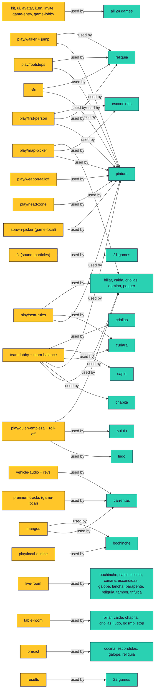

# Shared engine map

Read this before you build a mechanic. If a row below already does it, use it.
If you build something a second game could use, put it in `Pana/engine/` (`play/`
for mechanics, the kit for pages) and add a row here in the same change. How to
extend the rest of the engine lives in `AGENTS.md` ("Shared pieces") and
`Pana/engine/README.md`; this file is the map of who uses what.

"Used by" comes from imports found with `git grep` over `games/*/public` on
2026-10-30 (the audit commands are at the bottom). It lists games that import the
module, not games that merely look alike. All paths are relative to `Pana/`.

- **Shared** means two or more games import it.
- **Game-local** means it is good and generic but still lives in one game: a
  promotion candidate, listed under "Migration candidates".

## Records

`engine/records.js` (no DOM): `createRecordBoard({ game, metrics })` keeps each
player's best per metric under `pana:records:<game>` and answers who holds each
record (`holder`), the leaderboard (`table`) and, for a match, what fell since
it started (`startRun`, then `report` and `summary`). Reporting is idempotent, so
report every round. A tie keeps the older holder. The player's own bests also go
through `engine/stats.js` to the gateway. `engine/record-widget.js` draws it:
`renderRecord(node, board, { me, standings })` for the lobby or the end screen
(`compact: true` and a `data-room-personal` node in a lobby), and `recordLine(board)` for tight
spots.

```js
const board = createRecordBoard({ game: 'trompo', metrics: [{ id: 'wins', label: loc('Victorias') }] });
const run = board.startRun();
run.report([{ name: 'Ana', me: true, values: { wins: 3 } }]);
renderRecord(node, board, { me: 'Ana', standings: run.summary('Ana') });
```

A tally counts what has no value to beat, like an end-of-match title:
`createTitleTally({ game })` keeps per-player counts under `pana:titles:<game>`,
`add(receipt, [{ name, id }])` counts a match once and `of(name)` reads it back.
`renderTitleTally(node, tally, { names, me, label })` draws a row of chips per
name beside the record, and hides the node when there is nothing to show.

Used by: Fosa. Notes: `docs/knowledge/reliquia.md`, "The record".

## Save and resume

`engine/save-game.js` (no DOM): `createSaveStore({ game, version })` keeps the
newest few sessions under `pana:save:<game>` in the host's browser (`save`, `list`,
`load`, `remove`; a new `version` hides old saves), `createAutosave({ store, ready,
key, make })` writes when the game says it may, and `findSlot(slots, name)` finds a
returning player's slot. `engine/save-widget.js`, in the shared lobby's buttons and
cards: `renderContinue(node, saves, { describe, onContinue, onDiscard })` on a
`data-room-personal` node, and `renderSlots(node, { heading, slots, action })` on a
`data-pana-roster` one. The game decides what a save holds and what a missing
player does.

```js
const store = createSaveStore({ game: 'trompo', version: 1 });
const autosave = createAutosave({ store, ready: () => room.isHost && betweenRounds(), key: () => round, make: () => ({ id, data: room.state, meta: { round } }) });
renderContinue(node, store.list(), { describe: s => `${s.meta.round}`, onContinue: s => room.load(store.load(s.id)), onDiscard: s => store.remove(s.id) });
```

Used by: Fosa. Notes: `docs/knowledge/reliquia.md`, "Saved expeditions".

## Home plot

`engine/plot/` (no DOM, no Three.js). `plot.js`: `createPlot({ game, crops, tiers,
decor, shop, wallet, progress })` keeps a player's plot under `pana:plot:<game>`, in
the same shape as `progress.js` (injectable storage and clock, memory when storage
is blocked, a broken save is cleaned): `plant`, `harvest`, `harvestAll` (mangos and
XP each with a receipt from the plant, so they pay once), `upgrade`, `buy`,
`setDecor`, `isDecorUnlocked`, `stock`, `onChange`, and `view()` for what a page
draws. `growth.js`: `cropState(planted, crop, now)` is the whole of real-time and
offline growth, from a timestamp (`seed`, `sprout`, `young`, `ready`, `wilted`), and
`WILT` is how gentle neglect is: a day fresh, a day wilting, then half pay forever,
never dead. `rotation.js`: `rotatingStock(catalog, { salt, window, size, qty })` with
`rotationWindow(now, period)` is a shelf the same for everyone at the same moment,
from epoch time with no server. It walks a seeded shuffle, so an item returns only
after the rest. The tables are the game's. Models: `engine/models/props/conuco.js`.

```js
const plot = createPlot({ game: 'conuco', crops: CROPS, tiers: TIERS, decor: DECOR, shop: SHOP, wallet: createMangoWallet(undefined, { source: 'conuco' }), progress });
plot.plant(0, 'maiz'); plot.view().beds[0].stage; plot.harvest(0); plot.stock().items;
```

No public game uses it today: the Conuco game itself lives in the private pana.sh repo. Tests: `engine/tests/plot.test.js`.

## On foot

### Player controller (walk, sprint, stamina, collision)

`engine/play/walker.js`. `stepWalker(p, input, dt, opts)` is pure and runs on the
host and in a guest's prediction: movement vector, sprint with stamina, optional
inertia, collision through the game's own `move`, the jump and the floor height.
The game keeps its rules and passes numbers (`walk`, `run`, `canSprint`).

```js
import { stepWalker, slideMove } from '../../../engine/play/walker.js'; // relative: rules.js also loads on the server
const r = stepWalker(p, input, dt, { walk: 7, run: 10, canSprint: !input.fire, move: (q, dx, dz) => slideMove(q, dx, dz, (x, z) => !blocked(x, z), { slip: .5 }) });
p.sprint = r.sprinting;
```

Used by: Reliquia, Pepazo. Notes: `docs/knowledge/shared-player.md`.

`slideMove(p, dx, dz, free, { slip })` is the `move` for a body with a size: it
runs each axis up to contact and, with `slip` (the body's radius), rounds a corner
the body only grazes instead of stopping dead on it. `free(x, z)` says the whole
body fits there. Used by: Fosa (`layout.moveBody`, `moveAcross`), Pepazo. `axisMove` stops dead at
corners: a game with a body size wants `slideMove`.

### Jump

`engine/play/jump.js`. `pressJump(count)` (an 8-bit press counter so a press
survives a dropped packet), `jumpCount(input)`, `stepJump`, `resetJump`.
`stepWalker` calls it; a game with its own movement can call `stepJump` alone.

```js
input.jump = pressJump(input.jump);   // client, on the key edge
```

Used by: Reliquia, Pepazo, Capis a Pintazos (the press counter, through `side-walker.js`).

### Footsteps, take-off and landing

`engine/play/footsteps.js`. `createFootsteps()` returns a ticker that fires a step
every few metres (a longer stride when sprinting), alternating feet, plus take-off
and landing sounds, through `engine/sfx.js`.

```js
const feet = createFootsteps();
feet.update(dt, { speed, height: p.jumpHeight, sprint, surface: 'wood' }, sfx);
```

Used by: Reliquia, Pepazo.

### Four-legged gaits (walk, trot, canter, gallop)

`engine/models/animation/quadruped-gait.js`, no Three.js. `poseQuadruped(rig, phase,
speed, jump, climb, pose)` fills a reused pose: footfalls blended by ground speed, leg
IK with a hoof joint, body bob and pitch, head nod, delayed mane and tail. Advance the
phase with `strideRate(speed, blendGait(speed))` or the feet slide. Describe a new
animal's legs with `createQuadrupedRig`.

Used by: `engine/models/fauna/farm/rig.js` for the mounted horse, so Galope and
Bululú's Coleo. The cow keeps its own simple gait. Notes:
`docs/knowledge/procedural-farm-animals.md`.

### First-person look

`engine/play/first-person.js`. `createLookControls(canvas, {look, press, release})`
(mouse and touch look, pointer lock handling) and the saved sensitivity
(`loadSensitivity`, `SENSITIVITY_CHOICES`).

Used by: Escondidas, Pepazo, Reliquia.

### Side view: destructible ground and walking on it

`engine/play/terrain-mask.js` (pure): a grid of solid/air cells with a paint
layer, row 0 at the bottom. `createMask`, `fillHeights`, `carve` (round
crater), `carveLine` (a tunnel: a capsule along a segment, round at both
ends; Capis' La Licuadora), `fill`, `splash` (paint that fades to the rim), `drips` (seeded streaks
of paint running down from a blast and blobs thrown past its rim), `solidAt`,
`groundBelow`, `surfaceY`, `slopeAt`, `circleHits`, `surfaceNormal`, `stainAt`,
`markDirty`/`takeDirty`, and `paintRGBA` (texture bytes: grass on every top
surface, earth darkening with depth, paint blended over; upload as a
`THREE.DataTexture`, no canvas). Optional palette keys add a beach (`sand`,
`wet`, `sandBelow`), bare crater floors (`grassAt`), rock strata (`rock`,
`rockAt`), roots, grass blades drawn into the air (`fringe`), shade under
overhangs (`shade`) and darkening by height (`deepFrom`).

`fieldRGBA` writes the same ground as fields for a shader instead of colours
(a vertical signed distance smoothed along x, a blurred coverage, rock, bare
tops, paint, wide coverage for occlusion, the distance to air below), and
`coverageContour` traces the smooth outline (marching squares with normals).
`engine/play/terrain-material.js` (Three.js) draws them: `createTerrain(scene,
mask, { palette, rockAt, grassAt, zBack, zFront, back, renderer })` builds the
front face, a wall extruded from the outline and an optional back wall (the
starting ground plus `mask.hollow`), three draws in all, with soil, strata,
pebbles, roots, rock, sand, a grass band with short tufts and the paint all
computed in the fragment shader (Lambert lighting and fog kept).
`palette.strata` (keys of `DEFAULT_STRATA`: topsoil, ash, clay, pumice, ochre,
loam, base and seam colours, `period`, `fold`, `tilt`, `phase`) sets the soil
profile; `setStrata(strata)` swaps it for the next map without a rebuild.

**Strata.** The bands are read from the ground as it was at `reset()`, never
from the ground now, so a crater cuts through them and nothing pops or
stretches: the field is copied into a start texture (depth, coverage, wide
coverage, bare) and `smoothTops(mask, { extra, wide, narrow })`
(terrain-mask.js, pure) gives the starting top per column smoothed wide and
narrow, uploaded as a one-row half-float texture with the narrow top's slope
(`topSlope(tops, cell)`, terrain-mask.js) in its third channel. A point's place down the
profile is `fold` x its depth under the smoothed top plus the rest level (the
bands drape over hills and fold gently instead of running parallel to every
bump), waved and thickened along x by noise; runs of seven bands of five
kinds repeat every `period` units with shares, swaps and swells hashed per
run, some contacts sharp, some graded, some with a thin dotted seam. The
topsoil, the root fringe and the grass cover use the starting depth too (the
topsoil's thickness is meant at right angles to that slope, so a steep bank
keeps it thick, at most 2.6 times deeper straight down), and
where the coverage is now lower than at the start (a crater) the new face is
scorched, charred right at the edge. Two texture taps more than the plain
soil and about 30 value-noise lookups a pixel; no mesh, draw or pass added.
`update(takeDirty(mask))` after a blast or a splash (it rebuilds the outline
only when cells changed between solid and air), `reset(mask)` for a new
match, `fallback()` for a plain cut-out ground if the shader cannot compile.
`terrainMaterial` alone gives the material.

`engine/play/side-walker.js` (pure): `stepSideWalker(p, input, dt, mask, opts)`
walks a body left and right over the mask, steps over bumps, refuses bare
slopes steeper than `maxClimb`, slides down painted slopes (`slick`,
`slipAngle`), jumps on `jump.js`'s press counter, falls off ledges and into the
water (`drowned`); `knock(p, vx, vy)` throws it, `settled(p)` says it stopped.
It only lands with ground under the feet (brushing a rounded lip is a wall to
slide off), and a body wedged in a narrow V rests on the floor under it.

`engine/play/loose-prop.js` (pure): a thing lying loose on that ground (a crate,
a tombstone). `dropProp(fields)` makes one (`chute`: its steady speed down under
a parachute), `stepProp(p, dt, mask, { water })` drops it, rests it, drops it
again when the ground goes and sinks it (`landed`, `sunk`), `throwProp(p, x, y,
speed)` is a blast throwing it, `propTouches(p, x, y, reach)` measures from its
middle, so a pickup can be generous. Used by: Capis a Pintazos (crates and
tombstones).

`engine/play/terrain-gen.js` (pure): building and checking side-view ground
from a seed. `seededStream(key)` (one stream per seed and attempt, so a re-roll
replays), `bumps(d, hills)` (gaussian hills and hollows), `dropFloating(mask,
max)` (removes ground not joined to the bottom row, reports bigger pieces),
`topLine`, `walkSpans` (stretches a walker covers: walkable slopes and hops),
`walkTo(mask, x, dir)` (how far a walker gets one way, down ledges included),
`skyExposure` and `headroom`; `floorGraph(mask, { water })` (every floor a
walker stands on, caves, tunnels and bridges included, with walk, drop and
hop edges: `reach`, `distance`, `near`, `layered`), `coverToward(mask, x, y,
dir)` (how sheltered a spot is from one side) and `relief(mask)` (relief,
bumpiness and dry share of the top). The game keeps its own design (Capis:
`games/capis/public/map-rules.js`).

```js
import { createMask, carve, splash } from '../../../engine/play/terrain-mask.js';
import { stepSideWalker, knock } from '../../../engine/play/side-walker.js';
carve(mask, x, y, 3.5); splash(mask, x, y, 4.6, team);
const r = stepSideWalker(capy, { x: dir, jump }, dt, mask, { water: 4 });
```

Used by: Capis a Pintazos. Notes: `docs/knowledge/capis.md`.

### Spawn picker (game-local)

`games/pintura/public/spawn-picker.js`. `rankSpawns` and `pickSpawn`: pure,
seeded, choose the spawn farthest from enemies and not recently used, with an
optional line-of-sight test. Nothing in it is about paint.

Used by: Pepazo only. Promote to `engine/play/spawn-picker.js` when a second game
needs it (see candidates).

## Weapons and projectiles

### Projectiles (level flight, swept collision)

`engine/play/projectile.js`. Pure, so a server room and Node tests run the same
flight: `launch(ax, az, speed, angle)`, `sweep(ball, dt, { boxes, targets, padding, y })`
(the earliest cover box or round target along this step's segment, so a fast
ball never tunnels; with `y`, the flight height, boxes no taller than it are
flown over; a box with `trunk: r` is that exact circle for shots, unpadded, and
the result's `box` says which cover stopped it), `segmentBox`, `segmentCircle`,
`traceRay` (where a tracer line ends, same `y`) and `flightTime`.
`launchAimed(ax, az, pitch, speed, angle)` is the same launch tilted by a look's
pitch, `{ vx, vy, vz }` at the full speed: sweep that with `sweepArc` and
`gravity: 0` for a shot that goes where you look. `sweepArc` honours `trunk: r`
and reports `box` the same way.

```js
import { launch, sweep } from '../../../engine/play/projectile.js'; // relative: rules.js also loads on the server
const { t, victim, dx, dz } = sweep(ball, dt, { boxes: cover, targets: rivals, padding: .12 });
```

Arcs in a 3D court: `sweepArc(ball, dt, { boxes, targets, radius, height, gravity })`
sweeps one gravity step `{ x, y, z, vx, vy, vz }` as its chord against cover
boxes with a height (a low crate is flown over), upright round targets and the
ground (`hit`: 'cover' | 'target' | 'ground'), and `stepArc(ball, dt, gravity)`
moves it on. `engine/play/melee.js` throws with them.

Used by: Pepazo (every ball and rocket along the look, the sniper tracer, the thrown chancla).

### Collision debug (colliders vs what you see)

`engine/play/collision-audit.js` (pure): `auditColliders(colliders, solids, { map,
variant, shotHeight, allow })` measures each collider `{ id, source, x, z, w, d,
h, blocksShots, blocksMovement, health }` against the visible triangles inside
it and flags `no-mesh` (an orphan), `oversized` (under half its footprint or
60% of its height filled), `under-shot` (stops shots though its mesh is lower
than they fly) and `damaged` (health under 1 but still stopping shots), each
with a proposed `fix` (`remove`, `refit` to the mesh box, `split` into one box
per separate piece, `unblock-shots`). `allow` lists ids or sources that are invisible on purpose.
`engine/play/collision-debug.js` (Three.js, load it only when asked):
`collectSolids(root)` turns a map's meshes (baked and instanced too) into those
boxes; `createCollisionDebug(scene)` adds `audit`, colour-coded wireframes
(`show`), a console table and `download` (JSON).

Used by: Pepazo (`?debugCollision=1` or F9, Shift+F9 saves the report;
`npm run collision-report` audits every court headless into `Pana/reports/collision/`;
`--fix` records the fixes in `games/pintura/public/collision-fixes.js`). A box with
`shots: false` never stops a level `sweep`.

### Melee weapons (one target per swing, throwable)

`engine/play/melee.js` (pure, renderer-free). A weapon is data: `{ reach, arc,
windup, recovery, damage, knockback, sweetSpot?, throwable? }`; `throwable` is
`{ speed, lift, gravity, radius, damage, life, recall, returns: 'recall' | 'pickup' }`.
`createMelee()` is the state (`phase` ready / windup / recover / away, counters
`swings` and `throws`); `startSwing`, `stepMelee(state, def, dt)` (says
`'strike'` the step the windup ends, `'return'` when a thrown weapon is back,
`'ready'`), `swingHit(pose, targets, def, { boxes, radius })` (the ONE nearest
target in reach and inside the facing cone with no cover between, plus the
sweet-spot damage), `throwStart(state, def, pose)` (the projectile; the weapon
leaves the hand), `stepThrown(flying, dt, { boxes, targets })` (gravity arc on
`projectile.js`'s `sweepArc`), `readiness` (0..1 for a HUD bar), `recall`,
`swingInterval` and `aimThrow(def, distance)` (the pitch that reaches a target:
bots). Tests: `engine/tests/melee.test.js`.

```js
import { startSwing, stepMelee, swingHit, throwStart, stepThrown } from '../../../engine/play/melee.js'; // relative: rules.js also loads on the server
if (input.fire) startSwing(p.melee, def);
if (stepMelee(p.melee, def, dt) === 'strike') { const hit = swingHit(p, rivals, def, { boxes: cover }); if (hit) paint(hit.target, hit.damage); }
```

Used by: Pepazo (Los del pescozón: six melee weapons; La Chancleta's throw).

### Lobbed shots seen from the side (gravity and wind)

`engine/play/ballistic.js` (pure). `aimVelocity(angle, facing, speed)`,
`stepFlight(ball, dt, { wind, solid, targets, bounds })` (gravity, a sideways
wind push, the step swept against the ground predicate and round targets with
`projectile.js`'s `segmentCircle`, so nothing tunnels) and
`simulateFlight(start, opts)` (the whole arc and where it ends, with the
velocity it struck at: the aim preview and a bot's shot search use the same
flight). `FLIGHT` holds the default gravity (18) and wind force (7); pass
`gravity` and `windForce` per weapon (a flat slug with no wind, a heavy
shell). `stepBounce(ball, dt, { normal, restitution, friction, settle,
maxBounces, ...flight })` is the same step for a thing that bounces off the
side-view ground instead of bursting: on contact it backs up to free air and
reflects off `normal(x, y)` (terrain-mask.js `surfaceNormal`) or off a round
target, comes to rest (`ball.resting`) when slow on a floor, falls again if
the ground under it goes, and stops after `maxBounces` wedged in a crevice.
`simulateBounce(start, opts, { fuse })` runs it to the end of a fuse (it
returns early once at rest): the grenade's preview and bot search.

```js
const ball = { x, y, ...aimVelocity(angle, facing, power * 32) };
const { hit, victim } = stepFlight(ball, dt, { wind, solid: (x, y) => solidAt(mask, x, y), targets });
```

```js
const g = { x, y, vx, vy };
const r = stepBounce(g, dt, { solid, normal: (x, y) => surfaceNormal(mask, x, y, .5), restitution: .45, friction: .7 });
if (g.t >= fuse) explode(g.x, g.y);
```

Used by: Capis a Pintazos (all five weapons, their aim preview and the bot;
La Piñita bounces with `stepBounce`, and the bot bisects its throw power with
`lob.js` `solveLob` and values blasts with `falloff`).

### Thrown lobs in a 3D court (bounce, roll, blast falloff)

`engine/play/lob.js` (pure, renderer-free). `lobVelocity(ax, az, elevation, speed)`,
`stepLob(g, dt, { boxes, bounds, restitution, friction, roll, sticky })` (gravity;
floor and box-top bounces; box sides taller than the throw and the court's edge
reflect it; it rolls to `resting`; fast throws are sub-stepped so nothing
tunnels), `traceLob(start, opts, { dt, time, out, land })` (the whole throw into
reused points: where it lands first, its peak and where it is when the fuse
ends; `land` waits for touchdown), `groundAt`, `touched`, `falloff(distance,
radius)` (1 inside 40%, down to 0.35 at the edge) and `solveLob(reach, distance,
{ pitches })` (pitch and 0..1 power for a distance: bots, auto-aim). Boxes are
cover `{ x, z, w, d, h }`, the same as `projectile.js`.

```js
import { stepLob, traceLob } from '../../../engine/play/lob.js'; // relative: rules.js also loads on the server
stepLob(grenade, dt, { boxes: cover, bounds: { x: 27, z: 27 }, restitution: .4 });
const end = traceLob(start, opts, { dt: TICK, time: fuse, out: points, land: true }); // preview = server
```

Used by: Pepazo (grenades: the server flight, the aim arc, bots and the armory
range); Capis a Pintazos (`falloff` for every blast's paint, `solveLob` for
the bot's grenade throws).

### Damage falloff with range

`engine/play/weapon-falloff.js` (pure). A weapon's config `{ near, far, close,
min, round }` deals `close` up to `near` metres, then a straight line down to
`min` at `far` and beyond (never below `min`, rounded to whole units unless
`round: false`). `rangeDamage(config, distance, base)` gives the damage after
`distance` metres; with no config it returns the flat `base`, so a weapon
without one behaves as before. `falloffConfig(config)` validates and fills the
defaults. Tests: `engine/tests/weapon-falloff.test.js`.

```js
import { rangeDamage } from '../../../engine/play/weapon-falloff.js'; // relative: rules.js also loads on the server
const damage = rangeDamage(stats.falloff, Math.hypot(ball.x - ball.x0, ball.z - ball.z0), stats.damage);
```

Used by: Pepazo (La Lejana's body hits: 3 up to 10 m, 1 from 50 m).

### Head hits from any camera

`engine/play/head-zone.js` (pure). A flat shot is a ray from the shooter's eye
`y0` at `pitch`; `shotHeight(shot, travel)` is its height after `travel` flat
metres and `headHit(shot, travel, head, lift)` is true when a pitched shot meets
a victim at or over their head line (`lift`: their jump). A first-person client
sends its look pitch. Any other view has none to send, so the server derives
one with `aimedPitch(from, dir, targets, { cone, width, head, chest })`, never
from new client data: the closest target inside `cone` radians of the shot's
own flight line is the one aimed at; a line passing within `width` metres of
its centre aims at its head (the head is narrower than the body), wider at its
chest; no target in the cone returns null (a body hit). Store the returned
`target` on the ball and only count the head on that victim, so a shot that
reaches someone else is a body hit. Tests: `engine/tests/head-zone.test.js`.

```js
import { headHit, aimedPitch } from '../../../engine/play/head-zone.js'; // relative: rules.js also loads on the server
const aimed = !input.look && aimedPitch({ x: p.x, z: p.z, y0: EYE }, { x: ball.vx, z: ball.vz }, rivals, { cone: .12, width: .25, head: 1.6, chest: 1.1 });
const head = (ball.aimed == null || ball.aimed === victim.id) && headHit(ball, travel, HEAD_Y, victim.jumpHeight || 0);
```

Used by: Pepazo (La Lejana's one-shot head hits in first person and Ver la cancha).

### Scope and aim zoom

`engine/play/scope.js`. `createScope({ zoom })` eases a 0..1 aim blend in and out
and gives the narrowed `fov(base)`, the slower look `sensitivity()` and `scoped`
(past which the held weapon hides). `createScopeOverlay(document)` is the
full-screen scope picture (vignette, posts, hairlines, a lit dot). `scopedFov`
and `lookScale` are the pure formulas.

```js
const scope = createScope({ zoom: 3.5 }); scope.update(dt, aiming);
camera.fov = scope.fov(72); look(yaw * scope.sensitivity(), pitch * scope.sensitivity());
```

Used by: Pepazo (La Lejana scopes 3.5×, the other markers zoom 1.2×).

### Spectating while out (killcam, follow, overhead)

`engine/play/spectate.js`, pure numbers (no Three.js, nothing allocated per
frame). `createSpectator({ killcam })` is the state: `update(dt, { down, killer,
targets })` returns `'off'`, `'killcam'` or `'watch'`; `next()`, `prev()` and
`toggle()` (follow / overhead) switch, and `shot` says what the camera shows. A
target that goes down hands over to the next one (`nextLiving`); `cycleTarget`
is the wrap. `createSpectateCamera()` eases toward each pose and arcs over the
court on long moves; `followPose` (behind a pana's shoulder, stopped short of the
game's camera bounds through a `clip` callback) and `overheadPose` (the whole
court in frame) build the poses.

```js
const watch = createSpectator({ killcam: 1.6 }), rig = createSpectateCamera(), pose = createPose();
watch.update(dt, input);                 // input = { down, killer, targets }, reused
followPose(pose, head, aim, { clip }); rig.step(dt, pose); camera.lookAt(rig.look.x, rig.look.y, rig.look.z);
```

The game picks the targets: it only uses what the room already sends everyone,
and a team game passes teammates only. Used by: Pepazo (`spectate-hud.js` for the
label, keys and buttons; `scene.js` for the camera).

### Table flip

`engine/fx/table-flip.js` draws it, `engine/play/flip-control.js` is the button
and the cooldown, `engine/play/flip-rules.js` says who may (no DOM, a server room
can import it). `createTableFlip(THREE, { table, pieces, radius })`: `start(angle,
seed)`, and `draw(dt, () => stage.draw(dt))` in place of `stage.draw`. It poses
matrices for one render and never writes position or rotation, so nothing can be
left over. The message goes through `room.emote` (`TableRoom`) and arrives at
`room.onEmote`, beside the game, so state, turn and seq never see it.

Used by: Caída, Dominó, Ludo.

### Recoil and camera shake

`engine/play/recoil.js`. `createRecoil()`: `fire({ cam, shake })` kicks and climbs
the view, `shake(amount)` trembles it (hits, explosions), `update(dt, { decay })`
returns `{ kick, pitch, yaw, roll }` to add to the camera or a held model. No
`Math.random`: the shake is a sum of sines, so tests are exact. `shakeAt(distance,
power)` is how hard a blast that far away shakes you.

Used by: Pepazo (the first-person camera and the viewmodel kick), Capis a Pintazos (the side camera's kick and blast shake).

### What you hold in first person (hands, sway, bob, swing)

`engine/play/viewmodel.js` (pure, nothing allocated per frame) is the motion:
`createHeldMotion()` keeps one hand's clock (`equip` raises a new item from below,
`step` eases the sprint, `swing` starts a blow when a count goes up, `carry` writes
the bob, breathing, sprint carry, air dip and wall push), `swingPose` plays a pose
table (`MELEE_SWING`, or `swingTable(rest, offsets)` for your own) and `applyHeld`
puts it on an object (`side: -1` mirrors a left hand, `spread` brings it in on a
portrait screen). A row like `MELEE_CARRY` tunes how much of each it uses.
`engine/play/viewmodel-rig.js` (Three.js) is the hand: `createHandKit({ sleeve, glove,
cuff, scale, glow })` shares its geometries and materials (recolour with `setColor`,
`setCuff`), `kit.hand({ parent, side })`
makes a glove, cuff and sleeve (three draws, no shadows, no lights) with a `slot` for
the item, `setGrip('fist' | 'open' | 'cup')`, `follow(object)` to wrap another
object's pose, and a sleeve that always reaches a fixed elbow off screen, however
the hand turns. Tests: `engine/tests/viewmodel.test.js`.

```js
const kit = createHandKit({ sleeve: color }), rig = kit.hand({ parent: camera }), motion = createHeldMotion(), pose = [], carry = {};
rig.slot.add(model);   // +Y runs up through the fist
motion.equip(item.id); motion.step(dt, { sprint, down });
swingPose(motion.swing(dt, { swings, windup, recovery }), windup, recovery, pose);
applyHeld(rig.hand, pose, motion.carry(carry, { bob, sway, air, push })); rig.update();
```

Used by: Reliquia (both hands, a grip per item in `games/reliquia/public/grips.js`),
Pepazo (melee weapons in the shared hand, in the match and on the range; its markers
use the motion with their own recoil, reload and aim, and keep their own hands).

### Explosions, smoke trails and tracers

`engine/play/blast-fx.js` (Three.js). `createBlastFx(scene, puffs)`: `boom({ x, z,
size, color })` (flash, fireball, shock ring, smoke, paint and embers),
`trail(id, at, dt)` (smoke behind anything flying), `tracer(from, to)` (a bright
line that fades) and `update(dt)`. Visual only; when and where come from the
game's state. Sound is `sfx.boom(size)`. `boom({ ground })` sets the shock
ring's height (default .08, the floor); a side-view game passes the impact's,
and `boom({ front: true })` stands the ring up facing the camera's side.

Used by: Pepazo (La Bazuca and El Cohetón rockets, grenades, La Lejana's tracer),
Capis a Pintazos (the paint bazooka's blast).

### Flying bits: drops, clods, sparks, water rings

`engine/play/spray.js` (Three.js). `createSpray(scene, { shape, capacity, additive,
gravity, drag })`: a pool of bits drawn as one `InstancedMesh` (one draw while
any fly, none when idle), no allocation per frame or per bit. Shapes `drop clod
chip spark ring`. `burst(at, { count, color, speed, dir, cone, size, life, grow })`;
`update(dt, { solid, water, onWater })` adds gravity and drag, sticks a bit where
`solid(x, y)` (a flattened drop that soaks in) and drops it at the water line
with a callback for a ripple. `additive` bits glow and fade; `ring` bits lie
flat and grow.

```js
const drops = createSpray(scene, { shape: 'drop' });
drops.burst({ x, y, z }, { count: 40, color: '#e8569b', speed: 12, dir: { x: 0, y: 1 }, cone: 1.2 });
drops.update(dt, { solid: (x, y) => solidAt(mask, x, y), water: 4.2, onWater: ripple });
```

Used by: Capis a Pintazos (paint and water drops, clods of earth, sparks, rings
on the river).

### Paint markers, La Bazuca and its rocket

`engine/models/props/paintball-kit.js` (Three.js). `createPaintKit({ weapon, color,
attachments, charm, pattern, camo })` builds one of eighteen markers (`pistol
scatter rapid rocket sniper bazooka smg minigun slingshot revolver blunderbuss
sprayer sixshooter pdw carbine bullpup marksman lmg`; an unknown id draws La
Chispa) or a Studio melee piece: origin at the grip, +Z down the barrel,
`userData.tip` the muzzle's z, `userData.sight` the sight line (`sightX` its
sideways offset for side-mounted sights), `userData.bore` the barrel axis
height, `userData.optic` the Mira kind when one is fitted, `userData.class`,
`userData.spin` (a group to turn when firing: La Licuadora, the revolvers).
Attachments `barrel hopper stock optic` sit on each marker's own mounts
(`opticKind` swaps the mount's Mira kind, `hopperScale` sizes the hopper);
`PAINT_PART_LABELS[id]` is the name every mesh of a fitted part starts with
(melee `tape drip strap` too), so a menu can frame or draw one part alone.
`PAINT_KIT_BORE[weapon]` is the barrel axis height for all eighteen.
`bakePaintKit(options)` is the same marker batched into a few draws (finishes
folded to matte, glossy and metal, one draw each), with `tip`, `sight`,
`sightX`, `optic` and `bore`; `.clone()` shares it, so a scene holding six
launchers in third person pays for one.
`createPaintRocket({ color })` is La Bazuca's round in flight (+Z the nose).
`createPaintGrenade({ color })` is Pepazo's paint grenade (about 30 cm, upright,
origin at its centre; `userData.light` is the fuse lamp's material to blink).
`createPaintVest()` is El Acolchado, a plate carrier in a pana's world units (one
vertex-coloured mesh); `wearPaintVest(character, vest?)` puts it on a
`buildCharacter()` pana's body so it follows the walk bob and lean.

Camo goes on by id only: `camo: '<id>'` names a `PAINT_CAMOS` pattern (selva,
medanos, bolivar, caracas, caribe, jaguar, llanero, rumba, tricolor, pepazo) or
a `PAINT_SOLIDS` colour (`liso-mango`, `liso-caribe`, `liso-uva`, `liso-crema`,
`liso-carbon`, `liso-coral`); free colour objects are ignored (`resolveCamo`).
A solid one only recolours the painted body (`userData.camo.pattern` is
`'solid'`, no shader, no extra attribute). A pattern is a shader hook on the
painted body (`applyCamo`, patterns in `CAMO_PATTERNS`) reading a `camoPos`
attribute baked in model space, so it wraps every part without UVs. All camo
materials share one program (`customProgramCacheKey` is the fixed
`'pana-camo'`; colours and pattern are uniforms set once per material at
compile, nothing per frame), and `engine/models/core/static-batch.js` keeps
`camoPos` through a bake. Used by Pepazo (its armory, held and third-person
markers); who owns which camo is the game's rule, not the model's.

The data behind it is `engine/models/props/paint-arsenal.js` (no Three.js,
no imports, safe in rules and on the server): `PAINT_WEAPONS` (id → name, menu
order), `PAINT_MELEE`, `PAINT_WEAPON_CLASSES` (eight marker classes plus
granadas and melee, ids and weapons only), `weaponClassOf(id)`, `PAINT_MOUNTS`
(which attachments each model has a mount for), `PAINT_OPTICS` (the Mira kind
each model draws: dot, holo, laser, scope, pin), `PAINT_KIT_BORE`,
`PAINT_CAMOS`, `PAINT_SOLIDS`, `PAINT_CAMO_IDS` (every camo id, solids first)
and `PAINT_GRENADES` (Pepazo's thrown grenades by name; Capis'
`tests/weapons.test.js` keeps them equal to `armory-data.js` `GRENADES`).
Game code reads it through `engine/play/paint-arsenal.js`, which re-exports
all of it and adds `PAINT_CLASSES` (each class with its nickname and kind
through `loc()`) and `classOf(id)`; the models layer may not import `play/`
or `i18n.js`, so the player-facing names live there. The kit re-exports the
model data (not `PAINT_GRENADES`, `PAINT_CAMO_IDS`), its `classOf` giving
`{ id, weapons }`. Pepazo's `armory-data.js` builds its markers, attachment
rules and optic tuning from it; `games/pintura/tests/paint-kit.browser.js`
builds every marker with every allowed attachment set and keeps the model and
the table in agreement.

```js
const launcher = bakePaintKit({ weapon: 'bazooka', color }), held = launcher.clone();
held.position.set(0, -launcher.userData.bore * s, 0);   // barrel axis through the pivot
```

Used by: Pepazo (every marker in first and third person, the in-flight rocket),
Capis a Pintazos (its five weapons by these names: La Bazuca, La Lejana,
La Licuadora and El Trueno batched in every capi's paws, La Piñita's
`createPaintGrenade` held and in flight; the rocket in flight).

## Sound

### SFX library

`engine/sfx.js`. One synthesised library, no audio files, on the same WebAudio
context and voice budget as `fx.js`: `step(surface)`, `jump`, `land`, `shot(kind)`,
`impact`, `splat`, `boom(size, { far })`, `debris`, `patter`, `hitConfirm`, `hurt`, `reload(kind)`, `reloaded`, `dry`,
`swap`, `swish`, `tick`, `confirm`, `back`, `count`, `go`, `boing`, `squeak`,
`splash(size)`, `chime`, `sting(win)`. Shots include `sniper` and
`bazooka`; reloads include `bolt`. Building blocks: `burst`
(filtered noise) and `pitch` (tone). A game asks for what a sound is, never how it
is built.

```js
import { sfx } from '/engine/sfx.js';
sfx.shot('scatter'); sfx.step('grass', { sprint: true, foot: 1 });
```

Used by: Pepazo, Reliquia (steps, jump, landing), Capis a Pintazos (bazooka,
boom with distance, debris, patter, splat, boing, splash, chime, tick, sting). Notes: `docs/knowledge/shared-sfx.md`.

### Character voices

`engine/voice.js`. A cartoon voice per character for its own reactions:
`hurt` ("eep"), `oof`, `jump`, `ko`, `win`, `taunt`, `dizzy`, `rise`, as tone
glides from `sfx.js`'s `pitch`. The pitch, pace and timbre come from a hash of
the character's id, so it sounds the same all match and on every screen. One
character speaks at most every 0.35 s and at most two lines start within
0.3 s; lines use voice priority 1, below shots, hits and cues. Nothing plays
before audio is unlocked or while muted; the master volume applies.

```js
const voices = createVoices({ sound, pitch });   // sound from fx.js, pitch from sfx.js
voices.say(capi.id, 'hurt', { volume: .8, delay: 0 });
```

Never for music, UI, shots, explosions or a cue the player needs. Used by:
Capis a Pintazos (hit, jump, out, the winner), Trifulca (hit, trompón, dizzy,
caída, rise, fuera, taunt, the winner). Test: `engine/tests/voice.test.js`.

### Sampled clips (short MP3s a game ships)

`engine/sample-bank.js`. `createSampleBank(sound, base, sets)` loads a game's
own clips (`public/audio/*.mp3`, credits in its `audio/SOURCE.md`) on first use
or `preload(...sets)`, decodes them once and plays them on the shared `fx.js`
graph, so volume, mute and the voice budget apply. `play(set, { gain, rate,
jitter, detune, delay, at, listener, range, pan, priority })` picks a random
take that is never the last one, re-pitches it a little and, given `at` and a
`listener` `{ x, z, yaw }`, makes it quieter with distance and pans it; at most
`maxVoices` (6) clips sound at once. `bed(set).set(level, seconds)` is a
looping bed that fades in, glides, and fades out and stops at 0 or while muted.
A clip that fails to load is silence. Pure helpers: `pickVariant`,
`distanceGain`, `panFor`.

```js
const bank = createSampleBank(sound, new URL('./audio/', import.meta.url), { drip: ['drip_1', 'drip_2'], wind: ['wind_loop'] });
bank.play('drip', { gain: .1, at: { x, z }, listener: { x: me.x, z: me.z, yaw: heading }, range: 20 });
bank.bed('wind').set(playing ? .04 : 0, 2);
```

Used by: Reliquia (`games/reliquia/public/samples.js`: steps on wood and
stone, hiding-spot searches, book heaps, chandelier chains, wind and drips,
whispers and far scares). Chapita still loads its swishes by hand (a
migration candidate). Tests: `engine/tests/sample-bank.test.js`.

### Vehicle audio

`engine/vehicle-audio.js` (`createMotor`, `createTyres`, `vehicleSfx`) and its pure
half `engine/vehicle-revs.js` (gearbox and rev model, unit-tested). Profiles:
`compact sport muscle truck beetle bus boat`.

```js
const motor = createMotor(sound, { profile: 'muscle', topSpeed: 42 });
motor.update(dt, { speed, boost });
```

Used by: Carreritas (tyres, boost, crash, via `drift-audio.js`; `createWind` and `vehicleSfx.whoosh` through `speed-feel.js`). Carreritas' car motor is the older `sound.startEngine` putt-putt in `engine/fx.js`, which sounded better to players than `createMotor`; `createMotor` has no user right now.

### Fire

`engine/fx/fire.js` (Three.js) and `engine/fx/fire-sim.js` (its numbers, no Three.js,
tested in `engine/tests/fire-sim.test.js`). `createFire({ height, radius, seed, quality,
calm, reach, emberSize, onCrackle })` returns `group`, `update(dt, time, { distance })`,
`feed(strength)`, `setQuality(level)`, `setLevel(0..1)`, `dispose()`, and `light`
(`intensity`, `x`, `y`, `z`, `warmth`): what the fire does to a warm light you lend it.
It owns no light, so a game's fixed light pool stays fixed. Two draws per fire: one
instanced shader for the tongues in layers and the halo, one Points for the embers,
which are a capped pool. `quality` is `baja` | `media` | `alta` (`getSettings().detail`):
`baja` is three cards, one noise octave, no halo and few embers. `calm` shrinks the
wander for reduced motion. `onCrackle({ strength, x, y, z })` fires when a spark pops,
so sound stays with the game. Retune everything in `FIRE_TUNING`, at the top of
`fire-sim.js`. Scene fog applies on its own.

Used by: Fosa (braziers and the campfire, `games/reliquia/public/scene.js`).

### Rock cracks

`engine/fx/rock-crack.js` (Three.js) and `engine/fx/rock-crack-sim.js` (its numbers, no
Three.js, tested in `engine/tests/rock-crack-sim.test.js`). `createRockCrack({ rock, faces,
faceWidth, seed, quality, motion, color, ground, chipColor, onEvent, dust })` takes any
Object3D in the scene and returns `group`, `setProgress(p, { viewer, silent })`,
`hit(point, normal)`, `break({ silent })`, `update(dt)`, `setQuality(level)`, `done` and
`dispose()`. Give it a progress your game already shares: cracks grow and burn brighter
with it and hits come from the thresholds it crosses, so every client sees the same
breaking without a message of its own. Presentation only, with no rule or state in it.
Cracks are laid on the rock's real surface by raycasts, once, the first time it starts
to break. Three extra draws while it is working: cracks, chips and chunks in one instanced
mesh, sparks; capped pools, so a burst cannot grow them. `onEvent` gets `hit`, `crunch` and
`break` for your sounds and `dust` asks for a puff of your own, `motion: 0` stills the shake
for reduced motion and `color` tints the cracks. Retune it in `CRACK_TUNING`. Not a mining
system: it awards nothing.

Used by: Fosa (cave-ins; `syncRubble` in `games/reliquia/public/scene.js`, lazy-loaded).

### Lights that do not blind up close

`engine/fx.js`: `capSpotNearField(metres)` stops every SpotLight gaining strength
inside that distance, so a lamp on the camera does not burn what comes within reach to
a white disc. Call it before anything compiles; it patches three's shared chunk, so it
applies to the whole page. `fadePointsNear(material, { from, to })` fades a
`PointsMaterial` as it reaches the camera, for additive glows that would otherwise fill
the screen. Used by: Fosa (`view.js`, `eco-view.js`).

### Carved surfaces

`engine/fx/pom.js` (Three.js) and `engine/fx/pom-sim.js` (its numbers and height maps, no
Three.js, tested in `engine/tests/pom-sim.test.js`). Parallax occlusion mapping on a
`MeshStandardMaterial`: each fragment walks its view ray down a height map, so a wall looks
carved with no added geometry. The outline stays the mesh's own (no discarded fragments, no
depth writes). `createPomSet()` is the usual way in: `set.add(material, 'brick' | 'rock')`, and
it swaps the material by itself when the picture setting changes.

- **Who gets it.** `pomGate`: top detail (`getSettings().detail === 'alta'`) on a device that is
  not touch-only. `?pom=0` and `?pom=1` in the address beat everything. Otherwise a material with
  UVs is three's stock normal map, no patch; one without UVs gets one tap of the projected normal.
- **By hand.** `applyPom(material, { heightMap, projection, tile, depth, steps: [min, max], refine,
  fade: [near, far], cavity, normalScale, selfShadow, debug })`, `applyRelief` (the plain version)
  and `clearRelief`. `reliefMap('brick' | 'rock')` is the shared texture: normal in RGB, height in A.
- **`projection`.** `'uv'` uses the mesh's UVs. `'world'` needs only positions, for baked low-poly
  meshes: the facet's dominant axis picks the projection and `tile` is metres per repeat. Both take
  their frame from screen derivatives, so no tangent attribute, and both work on instanced meshes.
- **`depth`** is real metres. Layers follow the view angle (`pomSteps`), a fragment past
  `fade[1]` skips the walk, and an edge-on sliver stays flat.
- **`selfShadow`** dims direct light by a four-tap walk toward the first directional, point or spot
  light. Off by default; a lamp on the camera casts no visible shadow.
- **`debug`** draws each fragment's layer count over the maximum, for QA.
- Retune in `POM_SURFACES`, at the top of `pom-sim.js`. The maps are generated on first use, about
  50 to 90 ms each on a desktop, and are the same bytes on every device.

```js
const { createPomSet } = await import('/engine/fx/pom.js');   // lazy: stays off the first load
const relief = createPomSet();
relief.add(wallMaterial, 'brick');
```

Used by: Fosa (ruin bricks and the camp's rock; `carve` in `games/reliquia/public/scene.js`). Notes:
`docs/knowledge/reliquia.md`, "Carved bricks and rock".

### `fx.js` sound, particles and bubbles

`engine/fx.js`. `sound` (the older shared effects and the one audio context),
`Puffs`, `Shockwaves`, `Debris`, charge ring, speed lines, `popCounter`,
`flyToCounter`, speech bubbles. Used by 21 games (all but Billar, Caída
and Dominó, which load it on first use through `engine/lazy-sound.js`).
`engine/sfx.js` sits on top of it.

### Eerie events (horror pacing)

`engine/eerie.js` (pure, seeded, no Three.js): `createEerie({ seed })` decides
when something unsettling happens on one screen: flickers, a slam, a thud in
the next room, whispers, a far silhouette, a fog surge, a stuttering lamp,
falling books, and rare jump scares (at least 80 s apart, never in the first
20 s of a level, never two in a row). `update(dt, { active, time, codicia,
depth, alone, hp, theme, mode })` returns the events to show; `eerieIntensity`
scales them; `mode` is the player's "Sustos" setting (`SCARE_MODES`: normal,
suaves, apagados). Events are cosmetic and client-local: nothing is synced.
`scareSound(mode, event.roll)` says how a sampled scare sound plays under that
setting (full; a quieter, far half; or none) without drawing from the seed.

```js
const eerie = createEerie({ seed });
for (const e of eerie.update(dt, { active: underground, time, codicia, mode })) show(e);
```

Used by: Reliquia (`games/reliquia/public/eerie-fx.js` turns events into
lights, sounds and shapes). Tests: `engine/tests/eerie.test.js`.

### Noise and hearing (hunting by ear)

`engine/play/noise.js` (pure, no Three.js): a host's ears for creatures that
hunt by sound. `createNoiseBoard()`; `emitNoise(board, { x, z, floor, radius,
kind, source, time })` where something loud happens (a steady source updates
its own entry instead of piling up); `hearNoise(board, at, { floor, since,
time, muffled })` is the newest noise that reaches a listener (`muffled(n)`
may shrink one behind walls); `noisySince(board, source, since)` says whether
a player made noise just now; `pruneNoises(board, time)`. Keep the board out
of snapshots.

```js
emitNoise(g.noise, { x: p.x, z: p.z, floor, radius: 10, kind: 'run', source: p.id, time: g.time });
const heard = hearNoise(g.noise, enemy, { floor, since: enemy.heardAt, time: g.time });
```

Used by: Reliquia (El Lector, `games/reliquia/public/lector.js`; the noise
reaches are `NOISE` in `rules.js`). Tests: `games/reliquia/tests/lector.test.js`.

### On a player's screen (view cone)

`engine/play/sight.js` (pure): `watcher(p, eyeHeight, out)` turns what a
player publishes (`x`, `z`, `y`, heading `h`, `pitch`) into an eye with a
cached sin/cos; `inViewCone(eye, { x, z, y0, y1, r }, { half, vhalf, range })`
says whether a body could be on that player's screen, with a field of view
(`VIEW`) wider than any real one so it errs on "seen". Pair it with the game's
own occlusion ray (Reliquia: `layout.sightClear`).

Used by: Reliquia (La Estatua only moves unseen, `estatua.js`). Tests:
`games/reliquia/tests/estatua.test.js`.

### Hiding spots (search to find)

`engine/play/hiding-spots.js` (pure, seeded, no Three.js): places a player has
to search before they give up what they hide. `dealHidingSpots(rng, places,
{ treasures, lesser, junk, traps })` deals a level's treasures into the places
(harder places more often, the first one easy; extras share a place), then
fills the rest with junk decoys, minor finds, a rare trap or nothing.
`searchStep(store, id, dt, need)` adds a held key's progress and is true once,
when the search completes; `decaySearches(store, held, dt)` fades the ones
nobody holds. Host and guests deal the same spots from the seed, so a snapshot
only carries which are open. On a client, `searchesStarted(store, seen, start)`
calls `start(id)` once when a search begins (Reliquia plays its creak there).

```js
const { spots } = dealHidingSpots(rng(seed), places, { treasures: ['mask', 'cup'], junk: ['oldBook'], traps: ['spider'] });
if (searchStep(state.searching, spot.id, dt, spot.need)) open(spot);
decaySearches(state.searching, held, dt, { done: id => state.spots[id] });
```

Used by: Reliquia (the library's drawers, trunks, dust sheets, wardrobes,
heaps of books, rolling shelves and ladders, old lanterns; `deck.js` places
them, `rules.js` searches them). Models: `props/reliquia-hideouts.js`
(`userData.open(t)` poses each piece from shut to searched). Tests:
`engine/tests/hiding-spots.test.js`, `games/reliquia/tests/hiding.test.js`.

### Living food chains (ecosystem)

`engine/ai/ecosystem.js` (pure, seeded, no Three.js, plain JSON state): creatures
that eat, breed with slightly mutated traits (`sight`, `hear`, `pace`) and starve,
on a plant and a pest that live on the map's sites. Sight costs energy
quadratically and needs light, so dark places breed near-blind lineages that go by
ear. Cover shields what is inside, which is what keeps the numbers in waves.
`ecoWorld(sites, { species, clear })` is static and never travels;
`createEcosystem(world, { seed, depth, founders })` is the state;
`advanceEcosystem(eco, world, dt, { noises, on })` steps whole seconds, so a
population of 40 costs far under a millisecond and changes the wire once a second.
`coverAt`, `coverOf`, `lightOf`, `dimmed`, `traitsFor`, `meanTrait`,
`removeCreature`, `addCreature` read and edit it. A game gives bodies only to the
creatures near its players.

```js
const world = ecoWorld(sites, { species: { bat, snake }, clear: (a, b) => L.sightClear(a, b) });
const eco = createEcosystem(world, { seed, depth, founders: [{ sp: 'bat', at: 3 }] });
advanceEcosystem(eco, world, dt, { noises, on: (kind, c) => { if (kind === 'extinct') say(c.sp); } });
```

Used by: Fosa (`games/reliquia/public/ecology.js`, notes in
`docs/knowledge/reliquia.md`, "The food chain"). Models: `mushroomThicket` in
`props/glow-mushrooms.js`, `rootThicket` in `props/fosa-biomes.js`, `batColony` in
`fauna/cave-creatures.js`. Tests: `engine/tests/ecosystem.test.js`,
`games/reliquia/tests/ecology.test.js`.

### Crowds of crawling things: chains, distance fields, flow fields

Four small renderer-free modules in `engine/play/`, usable together or alone. All are
allocation-free once built.

- `distance-field.js`: `bakeDistanceField({ w, h, cell, x0, z0, solid })` makes a signed
  2D field from any grid. `at(x, z)`, `sample(x, z)` (way out in `gx`, `gz`), `clear(ax, az, bx, bz, margin)`.
- `spatial-hash.js`: `SpatialHash` answers "who is near?" through neighbouring cells only.
- `flow-field.js`: `flowFromField(field)`, one search for any number of walkers.
  `add` the targets, `compute`, then `toward(x, z)` gives the way in `dx`, `dz`.
- `verlet-chains.js`: `VerletChains`, chains of point masses that keep their length, stay
  out of a field and apart through a hash. `nudge` steers a head, `scatter` throws
  points apart until they reform.

```js
const chains = new VerletChains({ chains: 100, points: 12, rest: .17, field, gap: .16, grid: { cell: .4, x0, z0, w, h } });
chains.place(0, x, z);
flow.toward(chains.x[0], chains.z[0]); chains.nudge(0, flow.dx * speed * chains.h, flow.dz * speed * chains.h); chains.step();
```

Draw them with `createSnakeInstances` (`engine/models/fauna/snake-swarm.js`): one
`InstancedMesh` per part, three draw calls at any count. Used by: Reliquia (`swarm.js`,
150 snakes x 12 points in under 1 ms a step). Tests: `engine/tests/distance-field.test.js`,
`spatial-hash.test.js`, `flow-field.test.js`, `verlet-chains.test.js`.

### Music

`engine/music.js` (+ `music-tracks.js`): songs, styles, the lobby song.
Used by: Carreritas, Curiara, Lancha, Parapente; the lobby plays it for every game
through `game-entry.js`.

## Lobby, menus and the match flow

### Lobby and ready handshake

`engine/game-entry.js` (page `data-pana-entry`) paints the illustrated lobby
before the game's module graph loads, tracks each player's `lobbyReady` and
`assetsReady`, and holds the start barrier until everyone is ready. Styling:
`engine/game-lobby.css`, `engine/banderin.css`, `engine/sala.js` + `sala.css` (the
Sala layout). A game opts in by exporting `sceneReady` (a promise); the others
go through `engine/game-load.js` (`prepareScene`: compile and render once before
the cover lifts).

Used by: game-entry and game-lobby in all 24 games; `sceneReady` in Bochinche,
Caída, Carreritas, Chapita, Dominó, Ludo, Parapente, QQSMP, Stop, Tambor,
Trifulca; `game-load` in Billar, Bululú, Caída, Cocina, Criollas, Curiara,
Dominó, Embuste, Escondidas, Galope, Lancha, Ludo, Pepazo, Póquer, Reliquia.

### Round countdown (not shared)

Nothing in the engine draws the "3, 2, 1, ¡ya!" before a round. Eight games
write their own (Bochinche, Bululú, Carreritas, Curiara, Galope, Lancha,
Parapente, Pepazo). The only shared part is the beep: `sfx.count()` and `sfx.go()`, used by Pepazo.
See candidates.

### Roster, seats and starter

| Piece | Module | Used by |
|---|---|---|
| Team lobby (team panels in the main lobby, one list without teams; four seats a side as 2×2) | `engine/team-lobby.js` (`createTeamLobby`) on `engine/lobby-roster.js` | Billar, Caída, Capis a Pintazos, Chapita, Criollas, Curiara, Dominó, Pepazo (Póquer through table seating, as one list) |
| Team balance on join, who is a teammate | `engine/play/team-balance.js` (`smallestTeam`, `openSeat`, `isTeammate`) | Billar, Caída, Capis a Pintazos, Chapita, Criollas, Dominó, Pepazo |
| Lobby roster cards (portrait, seats) | `engine/lobby-roster.js` | only through `team-lobby.js`; `game-entry` uses its `portraitImg` |
| Seat swapping rules | `engine/play/seat-rules.js` | Billar, Caída, Chapita, Criollas, Curiara, Dominó, Pepazo, Póquer |
| Table seating UI (team lobby with team = seat % 2) | `engine/play/table-seating.js` | Billar, Caída, Dominó, Póquer |
| Seat bubbles (frases) | `engine/play/seat-bubbles.js`, `play/frases.js` | Caída, Dominó, QQSMP, Stop (bubbles); Caída, Dominó, QQSMP, Reliquia (frases) |
| ¿Quién empieza? (roll-off for the first turn) | `engine/play/quien-empieza.js` + `-rules.js`, `play/roll-off.js` | Billar, Bululú, Caída, Criollas, Dominó, Ludo, Póquer |
| Map picker, who may change it (`canChangeMap`) | `engine/play/map-picker.js` | Billar, Caída, Criollas, Dominó, Escondidas, Pepazo, Póquer |
| Results → lobby (pick the next map) | `engine/play/round-lobby.js` (`returnToLobby`; LiveRoom's `lobby` action calls `game.toLobby()`) | Escondidas, Pepazo, Trifulca |
| Difficulty picker | `engine/play/difficulty.js` | Billar, Criollas, Pepazo; Capis a Pintazos reads the levels for its bot and aim preview |
| Room options (fields, rules, finalize; primary choices as a square button grid, label above; compact "Más ajustes" grid in the game skin; `defaultOf(values)` for mode-dependent defaults; in-dialog help layer via `help: { controls, tips }`) | `engine/room-options.js`, `room-options.css`, `room-options-rules.js`, `room-option-fields.js` | 23 games; fields in 13; help layer in Pepazo |
| Results screen | `engine/results.js` + `.pk-results` | 22 games (not Bululú, Embuste) |

### Team lobby and auto-balance

Every team game shows its sides the same way: team panels in the main lobby
(title, colour, count, the cards with Unirme aquí, Cambiarme aquí and the host's
Organizar), never in "Más ajustes". Without teams it shows one list, or hides so
the lobby shell's player cards show. The game owns the seats: a key per seat
(what `onMove` receives) and the seat's team.

```js
import { createTeamLobby } from '/engine/team-lobby.js';
const lobby = createTeamLobby($('team-roster'), { onMove: (from, to) => room.moveSeat(from, to),
  titles: [loc('Naranja'), loc('Turquesa')], colors: ['#f28b42', '#29c5cd'] });   // default: Equipo A / B
lobby.update({ teams: teamPlay(options), seats: seats.map((player, key) => ({ key, team: key % 2, player })),
  ownId, hostId, enabled, canArrange: room.isHost, members });
```

`titles` may be a function (Curiara: one panel per canoe), `list: { title }`
keeps a single panel without teams (table games), `detail(player)` adds a line
to a filled card (Pepazo's kit, Chapita's batting style). Table games use
`createTableSeating`, which is this with team = seat % 2. Put the container
(it gets `data-pana-roster`) in the game's lobby markup: `engine/game-entry.js`
docks it in the main roster column for every game, the sala too.

A newcomer joins the smaller team: `openSeat(players, { teamOf, free })` from
`engine/play/team-balance.js` picks the first free seat of the smallest team
that still has one; a tie keeps the old first-free-seat rule. `smallestTeam(counts, prefer)`
is the same choice for games that store a team, not a seat (Capis). It is pure:
import it by relative path from rules a room loads. Curiara keeps filling one
canoe before the next, since a canoe is a crew of two, not a side.

Cards per row follow `rosterColumns` (`lobby-roster.js`): up to three in one
row, four as a 2×2 grid of compact cards, more in two even rows.

A game with `"teams": true` in game.json must render through this;
`tests/conventions.test.js` fails on a game that imports `createLobbyRoster`,
draws roster cards itself or keeps team lists in its lobby markup.

### Team objectives: flags and capture zones

`engine/play/objectives.js`. Pure, no Three.js: a server room, a practice host
and a unit test run the same rules. Actors are `{ id, team, x, z, alive }`
built from the game's players each tick; every step returns events
(`pickup`, `drop`, `return`, `capture`; `captured`, `neutral` for zones) the
game turns into scores, feed lines and sounds.

- Flags: `createFlag(team, stand)`, `stepFlags(flags, actors, dt, rules)`
  (carrier follows, drop on death or leave, capture only with your own flag
  home, own-team touch returns a dropped flag, rival touch lifts it, auto-return
  after `returnAfter` s), `dropCarried`, `carriedBy`, `returnFlag`.
- Zones: `createZone(id, { x, z, radius, captureTime })`, `stepZone(zone,
  actors, dt)` / `stepZones(zones, actors, dt)` (lone team turns it, +50% per
  extra pana up to 3×; two teams contest it; a rival's zone is neutralised
  first; an empty zone drifts back to its owner; events `contested`, `neutral`,
  `captured`), `zoneOccupants`, `zonesHeld(zones)`, `zonePoints(zones, bank, dt,
  perSecond)` (hold scoring with a per-team fraction bank).
- Match end: `reachedLimit(scores, limit)`, `decideWinner(scores, tieBreaks)`,
  `flagTieBreaks(flags)` (flag at home, then fewer times taken),
  `zoneTieBreaks(zones)` (more zones held now).

```js
import { createFlag, stepFlags } from '../../../engine/play/objectives.js'; // relative: rules run on the server
const flags = stands.map((stand, team) => createFlag(team, stand));
for (const e of stepFlags(flags, actors, dt)) if (e.type === 'capture') scores[e.team]++;
```

Used by: Pepazo (capture the flag, `games/pintura/public/ctf.js`; domination,
`games/pintura/public/domination.js`). Tests: `engine/tests/objectives.test.js`,
`games/pintura/tests/ctf.test.js`, `games/pintura/tests/domination.test.js`.

## Rooms and netcode

| Piece | Module | Used by |
|---|---|---|
| Real-time room | `engine/live-room.js` (`LiveRoom`, `axis`, `elapsedClock`) | Bochinche, Capis a Pintazos (turns with live walking and aim), Cocina, Curiara, Escondidas, Galope, Lancha, Parapente, Reliquia, Tambor, Trifulca |
| Turn-based room | `engine/table-room.js` | Billar, Caída, Chapita, Criollas, Ludo, QQSMP, Stop |
| Client prediction | `engine/predict.js` | Cocina, Escondidas, Galope, Reliquia |
| Snapshot deltas (send only what changed; a whole state on join, a new host, a guest's `resync` and every N publishes) | `engine/state-delta.js` (`diffState`, `patchState`, `createDeltaSender`, `createDeltaReceiver`); tests `engine/tests/state-delta.test.js` | Reliquia (`network.js`: `publish` and `receive`) |
| Raw room and links | `engine/net.js` | Bululú, Carreritas, Dominó, Embuste, Pepazo, Póquer |
| Shell (load, loops, teardown) | `engine/game-shell.js` (`bootGame`) | 17 games |
| Invite links | `engine/invite.js` | all 24 |
| Seeded random, noise | `engine/random.js` | 14 games |
| Gateway-vouched ownership (pana.sh signs `x-pana-camos` with `PANA_GATEWAY_SECRET`; `parseOwned(headers)` verifies the HMAC, timing-safe; mid-session `parseSub` + `newNonce` + `verifyRefresh` for a nonce-bound signed refresh) | `server/src/camo-trust.js`, read in a room's `onAuth(client, options, context)` | Pepazo (camos). The catalog and the bridge client stay game-local: `games/pintura/public/camos.js`, `camo-store.js` |

## HUD and UI

| Piece | Module | Used by |
|---|---|---|
| Look, fonts, `--pk-*` tokens | `engine/kit.css`, `engine/kit.js` | all 24 |
| One square UI style: `--pk-r*` radius tokens are 0, hard offset shadows (`--pk-drop`, `--pk-skin-shadow`); real circles (avatars, dots, swatches, joystick, spinners, balls) opt out with `var(--pk-radius-round)` | `engine/kit.css`; guarded by `tests/ui-square.test.js` (pana-kit.md, "One square style") | every page and game; Capis allow-listed while it is restyled |
| Game skin: the lobby room panel's look for any panel or dialog (`.pk-skin-panel`, `-card`, `-plate`, `-label`, `-chips`, `-btn`, `-go`, `-link`; `--pk-skin-*` tokens) | `engine/kit.css` (pana-ui.md, "Game skin") | the shared sala (`sala.css` reads the tokens) and "Más ajustes" in the 23 room-options games |
| Pause menu, settings, invite button | `engine/ui.js`, `engine/settings.js` | ui: all 24; settings: 16 |
| Sun shadows of still scenery drawn once per 8 m cell, not every frame (`cacheShadows(renderer, mapGroup)`, `refresh()` after adding to the same group) | `engine/shadow-cache.js` | Carreritas, Pepazo |
| "Editar pana" over the page: the Mi pana editor in a full-screen frame, so the room socket and a pana.sh party stay; a saved look fires `pana:avatar` on window | `engine/pana-editor.js` (`openPanaEditor`, `bindPanaEditorLinks`; `embeddedEditor` on the editor's side) | every lobby (`game-entry` "Cambiar pana" sends the room the new look), the hub; never a plain link to `/personaje` |
| Icons (`lock` marks something not yours yet; `weaponBazooka`, `weaponSniper`, `weaponDrill`, `weaponScatter` and `kitGrenade` for a weapon picker) | `engine/icons.js` | Billar, Bochinche, Bululú, Capis a Pintazos (room options, the weapon picker), Carreritas, Criollas, Ludo, Pepazo, Reliquia, Stop |
| Icons (`lock` marks something not yours yet; `person` beside a player count on the hub; `weaponBazooka`, `weaponSniper`, `weaponDrill`, `weaponScatter` and `kitGrenade` for a weapon picker; `kitBolt`, `kitShield`, `kitRegen`, `kitStep`, `kitRadar` for a class's effects) | `engine/icons.js` | the hub, Billar, Bochinche, Bululú, Capis a Pintazos (room options, the weapon picker), Carreritas, Criollas, Ludo, Pepazo, Reliquia, Stop |
| Toast | `engine/hud.js` (`createToast`) | Billar, Caída, Capis a Pintazos, Cocina, Criollas, Curiara, Dominó, Embuste, Escondidas, Lancha, Parapente, Reliquia |
| Hold to see more: a key (and the pad button that presses it, View → Tab through `createGameMenu({ pad })`) shows a layer while held; letting go, blur, a hidden page and a lost pointer lock hide it; `toggle('touch')` for a tap button | `engine/hold-overlay.js` (`createHoldOverlay`, pure `createHold`) | Reliquia (Tab / View: map, compass, jornada and team) |
| Touch controls | `engine/touch.js` | 17 games |
| Gamepad | `engine/gamepad.js` (`activePad`, `readPad`; a `[data-pad-play]` view inside a dialog is play, not that dialog's menu: right-stick `padLook`, B / Start click its `[data-pad-back]`; any other shown `[data-pad-back]` in an open dialog is its Atrás: B steps back through it instead of closing) | Carreritas, Trifulca, Pepazo's range (`data-pad-play`) and armory sub-menus (dialog `data-pad-back`); `ui`, `first-person`, `settings` and `game-entry` read pads for every game |
| Instrucciones page in the pause menu: goal, how to play, controls per device (keyboard, controller with its own button names, touch) switching live with the device in use, tips; never on the HUD | `engine/controls-page.js` (`mountControlsPage`, `normalizeInstructions`, `sectionsFor`; `.pana-help-*` in `ui.css`), data in each game's `public/instructions.js` | all games (through `engine/ui.js`) |
| River HUD, minimap, guide | `engine/river/hud.js`, `minimap.js`, `guide.js` | Curiara, Lancha (`river/hud` also Galope) |
| Combat HUD (Banderín style: race, pepas, hit arrow, KO plate) | `games/pintura/public/combat-hud.js`, `hud-model.js`, `hud-banderin.css` | Pepazo only (game-local) |
| Minimap | one per game | Bululú, Carreritas, Curiara, Embuste, Escondidas, Galope, Lancha, Pepazo, Reliquia each draw their own (Curiara and Lancha share `river/minimap`) |
| Shot charge and aim guide (`guideRibbon` strips, `guideBeads` for an arc in the air, `guideRing` for a landing or blast ring) | `engine/play/shot-charge.js`, `aim-guide.js` | Billar, Bululú, Capis a Pintazos, Criollas, Pepazo (charge: the grenade throw); Billar, Capis a Pintazos (dashed arc), Criollas (guide), Pepazo (grenade arc, ground strip and blast ring) |

### Game feel (damage, pixel effects)

Everything here only draws: no rules, no physics. `engine/fx/feel.js` holds what
they share: `calm()` (the browser's reduced-motion setting; the engine has none of
its own), `fxLayer()` (one click-through overlay) and `jolt(el)`.

| Piece | Module | Used by |
|---|---|---|
| Health bar: smooth drain, the lost chunk flashes white, orange, red, holds and drains; green, yellow, red by what is left; sparkles at the edge on a heal (`createDamageBar`, pure `createBarModel`) | `engine/fx/damage.js`, `damage.css` | Trifulca |
| Damage numbers: pop, fan out on arcs, scale with the amount; white, orange with jitter on a crit, green on a heal (`createDamageNumbers`); drawn-only knockback spring (`createKnock`) | `engine/fx/damage.js` | Trifulca, Pepazo (the numbers, on the hits you land) |
| Rank-up ceremony: riser, white flash, pillar and rings, the title slamming down, stats counting tick by tick, unlocks, confetti. `rankUpToast` plays it and `createRankChip`'s bar crawls through the last sliver, so any game on `engine/progress.js` gets both (`playLevelUp`, `riser`, `levelUp` and `countTick` in `sfx`) | `engine/fx/level-up.js`, `level-up.css`, `engine/progress-ui.js` | Reliquia, through `progress-ui` |
| Speed from the driver's seat: field of view 50 to 75 with speed, camera lag under acceleration that catches up with a small shake on its own noise (seeded dice untouched), how strong edge lines and wind should be. Pure numbers (`createSpeedFeel`); apply them with `setSpeedLines` and `createWind` | `engine/fx/speed.js` | Carreritas (`speed-feel.js`: comfort camera and battle arenas opt out) |
| A pickup you feel: flash and star burst where it was taken, the combo stamped over the counter at 3 and each full row (`createPickupFeel`); pairs with `flyToCounter` and `popCounter` from `fx.js` | `engine/fx/pickup-feel.js` | Carreritas coins |
| Spoken lines: a typewriter with holds at commas and periods, a blip per letter pitched per speaker, `<wave>` and `<shake>` tags, mood from how a line is written, a speaker's bob and squash (`typewrite`, `parseRich`, `blipPitch`, `moodOf`, `autoRich`, `speakerPose`; `sfx.blip`). `createSeatBubbles(…, { typer })` writes through it | `engine/fx/dialogue.js`, `dialogue.css` | QQSMP (host and contestants) |
| Cards and tiles with weight, as table meshes: hover lift and 3D tilt toward the pointer, pickup scale with a growing shadow, sway from speed, a spring home that overshoots (a hand closes its gap by itself), flick and slap (`createCardFeel`, pure `springStep`; `sfx.cardFlick`, `cardSlap`). A hand of HTML buttons gets the same through `bindHandFeel`: state keyed by card, so a rebuilt hand still closes its gap (`after()`) | `engine/fx/card-feel.js`, `hand-feel.js` | Dominó, Caída |
| Pixel effects as camera-facing sprites (`createWorldFx(THREE, scene)`) or on the HUD layer (`createScreenFx`): pooled, capped, loaded on first use so first load doesn't grow | `engine/fx/pixelfx-bridge.js`, code in `engine/vendor/pixelfx/` (MIT; keep its `LICENSE` and `NOTICE.md`; add an effect through its `README.md`) | Trifulca (`hit-spark`, `crit-hit`, `crit-number`), the rank-up ceremony (`level-up` without its pixel hero, `confetti`), pickups (`collect-burst`, `combo-counter`) |

## Player, look and rewards

| Piece | Module | Used by |
|---|---|---|
| Saved name and appearance | `engine/avatar.js` | all 24 |
| Pana model | `engine/models/characters/pana/avatar-model.js` | 19 games (not Curiara, Galope, Lancha, Parapente, Criollas) |
| Portraits | `engine/portrait.js`, `portrait-cache.js` | Bochinche, Trifulca |
| Menu card pictures of any 3D object (built, framed by its bounds, drawn once on the shared offscreen renderer, cached by key; `keep(mesh)` draws one part alone) | `engine/object-thumb.js` (`objectThumb(key, build, { width, height, turn, tilt, keep, margin })`) on `engine/snapshot.js` | Pepazo (armory cards: every weapon, part, charm and grenade) |
| Wardrobe | `engine/wardrobe.js`, `wardrobe-preview.js` | Bochinche, Carreritas, Pepazo, Trifulca (the page also loads `wardrobe-preview` through `pana.sh`) |
| Friend-named bots (the top 2-3 bots wear the names of the player's friends; `applyFriendNames`, `friendNamesNow`, `loadFriendNames`, `cleanJoinNames`) | `engine/bot-names.js`; server rooms use `hostFriendNames()` in `server/src/room-kit.js`, `engine/net.js` sends the list on join | Bochinche, Billar, Bululú, Caída, Carreritas, Chapita, Criollas, Curiara, Dominó, Embuste, Escondidas, Galope, Lancha, Ludo, Parapente, Pepazo, Póquer, QQSMP, Stop, Tambor, Trifulca |
| Mangos (shared currency; `spend` takes them or changes nothing, `peek` reads without adopting Carreritas' old coins; with `window.PanaSh.wallet` the account's server balance replaces local storage, and `ready` says when it arrived) | `engine/mangos.js` | Bochinche, Carreritas, Ludo (the mango die) |
| Rank and XP per game, on this device (`createProgress({ game, ranks, storage })`: `award(amount, receipt, { dive })` pays once and counts a dive unless `dive: false`, `rank`, `xp`, `isUnlocked`, `onChange`; pure `rankAt`, `nextRank`, `progressInRank`, `unlocksAt`, safe in rules and tests). The look: `createRankChip(progress)` (`.pk-rank`: title, thin XP bar, `gain(n)` for "+N XP") and `rankUpToast(result, show)` for a `createFeats` or `createToast` | `engine/progress.js`, `engine/progress-ui.js`; tests `engine/tests/progress.test.js` | Reliquia (`games/reliquia/public/progress.js`: the ranks and `xpFor`) |
| A game's day and streak (one seed and one rotating set per local date; pure `dayKey`, `dayNumber`, `isDayKey`, `dailySeed(game, day)`, `pickDaily(list, day)` walks the whole list before repeating. `createStreak({ game, storage, now })` under `pana:streak:<game>`: `record(day)` once a day gives `{ days, best, freezesLeft, usedFreeze, milestone }` (3, 7, 14, 30), a freeze every 7 days up to 2 covers one missed day; `peek(day)` reads without counting) | `engine/daily.js`; tests `engine/tests/daily.test.js` | Reliquia (`games/reliquia/public/daily.js`) |
| A discovery log per game, on this device (`createLogbook({ game, entries, storage })` under `pana:logbook:<game>`: `discover(id)` gives `{ isNew, entry, owned, total, percent }`, new once and never for an id outside the catalog; `has`, `owned`, `list`, `newest`, `percent` (rounds down), `onChange`). The look: `createLogbookChip(logbook, { text })` (`.pk-logbook`: chip and newest entry) and `createDiscoveryQueue(notify)`, one toast per find. Pay a first find with `progress.award(xp, 'logbook:<id>', { dive: false })` | `engine/logbook.js`, `engine/logbook-ui.js`; tests `engine/tests/logbook.test.js` | Reliquia (`games/reliquia/public/cuaderno.js`) |
| Feats, stats, kit rating | `engine/feats.js`, `stats.js`, `kit-rating.js` | Feats: Bochinche, Carreritas, Pepazo. Stats and kit rating: Carreritas, Pepazo |
| Text in other languages | `engine/i18n.js` (`loc`, `locn`, `locKey`) | all 24 |
| Your own pana's outline and marker | `engine/play/local-outline.js` | Bochinche; Capis a Pintazos (the marker only, over the capi whose turn it is) |
| Teammate chevrons (team rounds, own side only, through cover) | `engine/play/team-marker.js` (`createTeamMarkers`, `isTeammate`) | Pepazo |

### Your own pana: outline and marker

`engine/play/local-outline.js`. `createLocalOutline(group, { color, thickness })`
adds an inverted-hull copy of every opaque mesh in a character (skinned bodies
follow the pose) with one shared BackSide material and a slow pulse;
`createLocalMarker({ color })` is a small bobbing diamond that draws over walls,
placed by the caller. Both return `update(dt)` and `dispose()`; call `dispose()`
before `disposeModel` on the root. The hulls share the source geometry, so the
helper never disposes it. Use it for the local player only.

```js
const outline = createLocalOutline(character.group), marker = createLocalMarker();
root.add(marker.group); marker.group.position.y = height * 1.2;
outline.update(dt); marker.update(dt);   // every frame
```

Used by: Bochinche.

### Teammate chevrons

`engine/play/team-marker.js`. `createTeamMarkers({ height, size })` puts a small
chevron in the team colour over a pana's head; it keeps one screen size and
draws over cover. Call `set(group, show, color)` every frame per pana, with
`show = isTeammate(me, p, teamRound)` (never yourself, never without teams),
and `dispose()` with the scene. A full-body outline stays for your own pana
only (`local-outline.js`).

```js
const marks = createTeamMarkers();
marks.set(avatar.group, !down && isTeammate(me, p, teamPlay(state.options)), p.color);
```

Used by: Pepazo (team rounds, Bandera and Dominación too).

## Worlds and models

- **3D models** live in `engine/models/` (`catalog.js` is the index; the
  inventory is `docs/knowledge/model-inventory.md`). The pieces most games share:
  `props/game-table` (14 games), `characters/pana/avatar-model` (18),
  `vegetation/plant-kit` (9), `props/plaza` (9), `vegetation/palm` (7),
  `effects/water-surface` (6). Everything else is used by one to four games.
- **Worlds** in `engine/worlds/`: `table-world` (Billar, Bochinche, Caída,
  Chapita, Dominó, Ludo, Póquer, QQSMP, Stop, Trifulca), `sky` (Bululú,
  Carreritas, Galope, Parapente, Pepazo, Reliquia, Tambor), `arena-layouts`
  (Billar, Caída, Criollas, Dominó, Escondidas, Pepazo, Póquer), `arenas`
  (Cocina, Escondidas, Pepazo), `look` (Pepazo, Reliquia, Tambor), `plaza`
  (Cocina, Escondidas), `bolas-world` (Bululú, Criollas), the island set
  (Bululú), the coastal set (Carreritas, Parapente), `colonial-street`
  (Trifulca).
- **Glowing cave fungi**: `props/glow-mushrooms` has `glowMushrooms` (a floor
  clump, or `wall: true` for shelves; shared materials, so a map's clumps bake
  into a couple of draws) and `mushroomHalos` (every halo of a floor in one
  `THREE.Points` draw). No lights of its own: `userData.glow` says where one could
  go. Used by: Fosa.
- **Reliquia's boss**: `props/reliquia-boss` has `silbon` (posed by
  `userData.animate`) and `hideNook`; `fauna/cave-creatures` has `caveBat` (replaces
  the guácharo) and `props/mine` has `mineCart({ hollow: true })`, an open cart to
  fill with real objects. Used by: Reliquia.
- **The Congo set**: `props/congo` has `mokele` (posed by `userData.animate`, its neck one
  instanced mesh), `piragua`, `balsa`, `vineWalls` (a floor's vine walls and curtains in three
  draws), `jungleBackdrop` (two draws), `lilyPads` and `whirlpool`. Lazy-load it. Used by: Fosa.
- **Dusty interiors**: `props/reliquia-library` builds a room's bookcases
  in a few instanced meshes per call (`bookcases`, with variants: plain,
  arched, between stone pillars, with a ladder, collapsed, low), every small
  flame in one shader (`candleFlames`: flicker, dim and blow-out uniforms),
  sheer cobwebs that sway on one uniform (`cobwebs`: corner fans, sagging
  ceiling sheets, hanging drapes), dust motes around the eye (`dustMotes`),
  worn rugs (`rugs`), piles of books (`bookPiles`), low drifting mist for a
  few chosen rooms (`groundMist`), lit chandeliers and hanging lanterns, a
  glowing tall window and a hinged secret bookcase (`bookcaseDoor`).
  `props/reliquia-hideouts` has the searchable furniture (see "Hiding
  spots"). Used by: Reliquia's library.
- **Shooting range**: `props/shooting-range` builds a covered firing lane
  (`createRangeLane`: concrete floor with lane lines and distance numbers,
  panelled walls, ceiling baffles and strip lights, the berm, a booth with
  its bench and rail; baked into a few batches), hanging distance signs
  (`createRangeSign`) and targets (`createRangeTarget`: paper silhouette,
  board, popup on a hinge, big back board; `userData.face` is where splats
  go). Registered in Studio. Used by: Pepazo's armory range (`range.js`,
  `range-scene.js`, `range-sim.js`, the rules on a lane of dummy targets).
- **Large runtime asset packs** (audio, big images, voice packs) are not engine
  modules. They ship as release ZIPs pinned in `server/src/asset-packs.json`
  and are served by the server. Add a file there, not to Git:
  `docs/knowledge/asset-packs.md`.
- **Premium hook** is game-local: `games/carreritas/public/premium-tracks.js` is an
  empty extension point that a private build replaces (extra circuits, cups,
  modes, music). The engine has no premium or entitlement layer, and no other
  game has such a hook (Cocina's `rules.js` only mentions the word in a recipe
  name). If a second game needs paid content, build one in the engine first.

### Far copies of animated models (level of detail)

| Piece | Module | Used by |
|---|---|---|
| One-draw far copy of a jointed model (a pana and what it holds; give each swappable prop its own pivot and hide the unused ones) | `engine/models/core/rig-lod.js` (`createRigLod`) | Capis a Pintazos |
| Which copy to show at a distance, with hysteresis (pure) | `engine/models/core/lod-band.js` (`chooseFar`) | Capis a Pintazos |

`createRigLod(root, { pivots, cell })` merges every mesh visible under `root`
into one `SkinnedMesh` with one vertex-coloured material, each vertex bound to
its nearest ancestor in `pivots` (body, head, arms, legs, a held launcher), so
the far copy follows the animation the full model gets. `cell` welds vertices
(vertex clustering) for fewer triangles. `setFar(on)` swaps the copies by
layer mask, never `visible`, so game code that toggles meshes keeps working; a
hidden pivot collapses its part. For still props use `static-batch.js` or
`impostor.js` instead. A studio pana and its La Bazuca go from about 55 draws
to 1 and from about 56 k to 6.4 k triangles (cell 0.06).

```js
const lod = createRigLod(root, { pivots: [avatar.body, avatar.head, ...avatar.arms, ...avatar.legs, gun], cell: .06 });
lod.setFar(chooseFar(lod.far, camera.position.distanceTo(root.position), { far: 55, near: 47 }));   // every frame
```

## Diagram

Each arrow reads `module --> used by --> game`. Pieces every game imports are
collapsed into one node.



## Migration candidates

Found by pattern, not yet read line by line: check the game before you move it.

| Game | Has its own | Moves onto | Why it is worth it |
|---|---|---|---|
| Escondidas | on-foot speed and sprint in `rules.js` (4.6 / 6.2, no stamina), no jump or footsteps | `walker`, `jump`, `footsteps` | Already uses first-person look and `predict`; steps would make hiders audible |
| Cocina, Embuste, Trifulca | `x += ...` movement loops in `rules.js` | `stepWalker` (or `axisMove` alone) | One collision and speed model instead of three |
| Bululú minigames (Atrapa, Chinazo) | on-foot movement, sprint | `stepWalker` | Same |
| Bochinche | its own combat engine with spawns and respawns | `spawn-picker` | Pure and tested already; its audio is also outside `sfx` |
| Chapita, QQSMP, Tambor | raw `AudioContext` in `sounds.js` / `beat.js` | `sfx` for effects (voice packs and the beat stay) | One voice budget; no stray context |
| Chapita | its own swish-*.mp3 loader in `sounds.js` | `sample-bank` | Same fetch, decode and variant pick, already shared |
| Lancha | its own "motor drone" in `game.js` | `vehicle-audio` (a `boat` profile exists) | The boat motor is already written |
| 8 games (see Round countdown) | their own round countdown | a shared `engine/play/countdown.js` (3-2-1-go overlay + `sfx.count/go`) | Same markup and CSS written eight times |
| Reliquia, Bochinche, Trifulca, Cocina | their own spawn lists | promote `spawn-picker` to `engine/play/` | Pure and tested already |
| Pepazo | `combat-hud`, `hud-model` | keep game-local until a second shooter exists | Do not promote early |
| 9 games | a minimap each | a shared round minimap | Pepazo's is the newest; river games have another |

Not on the list: the table games (Billar, Caída, Dominó, Póquer, Criollas, Ludo,
Chapita, QQSMP, Stop) have no on-foot movement, and Carreritas has its own car
physics by design.

## Reproducing the audit

```powershell
# which games import a module
git grep -l -E "engine/play/walker" -- 'Pana/games/*/public/*.js'
# every engine module and its importers
git ls-files 'Pana/engine/*.js' 'Pana/engine/play/*.js'
```

Imports are matched by path, so a game that loads a module through a re-export or
a dynamic `import()` with a variable path can be missed; fix the row if you find
one.
